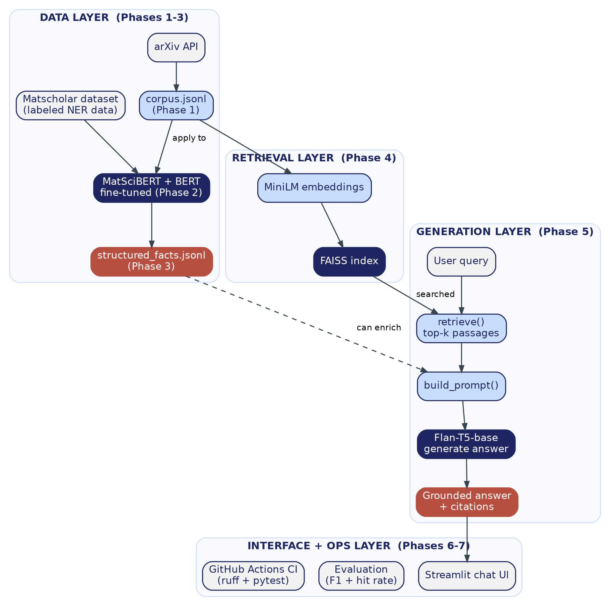
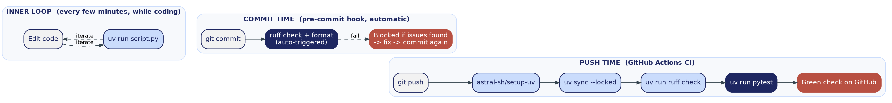
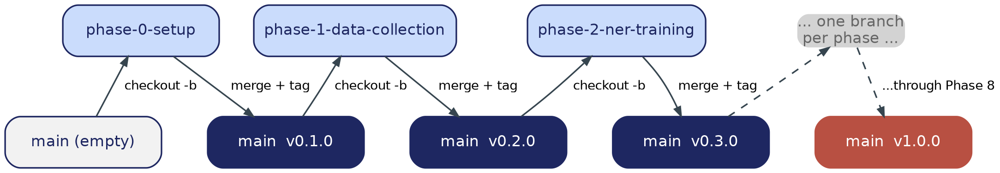

# MatSci-RAG — Build Guide
### Domain-Specific LLM Assistant for Materials Science Literature (RAG + NER)

> **Where this file lives:** `docs/build-guide/README.md`
> This is the landing page for the whole guide — start here, then open each phase file in order.

---

## What This Project Is

A system that answers materials-science questions by retrieving real passages from a curated arXiv corpus and generating answers grounded *only* in that retrieved text — plus a fine-tuned MatSciBERT NER layer that extracts structured (material, property) facts from the same corpus. Built as a direct, documented extension of a specific base paper (Maharana et al., 2025), addressing its own reported limitations (see the Zeroth Review document for the full base-paper and novelty argument this guide implements).

---

## System Architecture — The Whole Project at a Glance



Four layers, built up phase by phase:
- **Data layer** (Phases 1-3): collect abstracts, fine-tune and apply NER, extract structured facts
- **Retrieval layer** (Phase 4): make the corpus searchable by meaning
- **Generation layer** (Phase 5): turn a question into a grounded, sourced answer
- **Interface + ops layer** (Phases 6-7): evaluation, the Streamlit UI, and CI/CD

Nothing here is built out of order — each layer depends on the one below it already existing and being verified.

---

## How to Use This Guide

Work through the files **in order, one at a time.** Each phase file is fully self-contained: an overview of *why* the phase exists, diagrams, exact file structure before/after, git workflow, complete step-by-step implementation, a hard checkpoint you must pass before continuing, troubleshooting, and — where genuinely relevant, not by default — an honest note on what an IDE agent (Antigravity / Claude / Gemini) can and can't help with in that specific phase.

**Do not skip a phase's checkpoint.** Every later phase's code assumes the previous phase's output already exists and is correct — that assumption is what keeps debugging tractable.

---

## The Nine Files

| # | File | What It Builds | Tag on Completion |
|---|---|---|---|
| — | `README.md` | *(this file)* — index and architecture overview | — |
| 0 | `00_environment_setup.md` | uv, ruff, pre-commit, logging, config, folder structure, first git commit | `v0.1.0` |
| 1 | `01_data_collection.md` | arXiv corpus fetching → `data/corpus.jsonl` | `v0.2.0` |
| 2 | `02_ner_training.md` | Fine-tune MatSciBERT vs. generic BERT on Matscholar, compare F1 | `v0.3.0` |
| 3 | `03_ner_inference.md` | Apply the trained NER model to your own corpus → structured facts table | `v0.4.0` |
| 4 | `04_rag_indexing.md` | Chunk, embed, and index the corpus with FAISS | `v0.5.0` |
| 5 | `05_rag_generation.md` | Retrieval + grounded generation → `answer_query()` | `v0.6.0` |
| 6 | `06_evaluation.md` | Hand-written test questions → measured retrieval hit rate | `v0.7.0` |
| 7 | `07_ui_and_cicd.md` | Streamlit chat UI + real GitHub Actions CI | `v0.8.0` |
| 8 | `08_stretch_improvements.md` | Optional upgrades (self-verification, abstention, hybrid retrieval) | `v1.0.0` |

---

## The Daily Development Workflow



Set up once in Phase 0, then running automatically for the rest of the project: an inner loop (`uv run` while coding), a commit-time loop (pre-commit + ruff, blocking bad commits before they happen), and a push-time loop (GitHub Actions CI, giving an independent pass/fail signal).

---

## Git Branching Model Used Throughout



One short-lived feature branch per phase (`phase-0-setup`, `phase-1-data-collection`, ...), merged back to `main` only once that phase's checkpoint passes, tagged so every milestone is a restorable point in history.

**Commit message convention (Conventional Commits):**
```
feat: ...      new functionality
fix: ...       bug fix
docs: ...      documentation only
test: ...      adding/updating tests
chore: ...     tooling, config, dependencies -- no source logic change
refactor: ...  restructuring, no behavior change
```

---

## Tooling Stack Reference

| Concern | Tool | Set up in |
|---|---|---|
| Python env + packages | **uv** | Phase 0 |
| Dependency manifest | **pyproject.toml** + **uv.lock** | Phase 0 |
| Linting + formatting | **ruff** | Phase 0 |
| Pre-commit enforcement | **pre-commit** + ruff hooks | Phase 0 |
| Secrets/config | **.env** + **python-dotenv** | Phase 0 |
| Logging | Python **logging** module | Phase 0 |
| NER model | **MatSciBERT** vs. **bert-base-uncased** | Phase 2 |
| Embeddings | **sentence-transformers** (all-MiniLM-L6-v2) | Phase 4 |
| Vector search | **FAISS** | Phase 4 |
| Generation | **Flan-T5-base** | Phase 5 |
| Testing | **pytest** | Every phase |
| UI | **Streamlit** | Phase 7 |
| CI/CD | **GitHub Actions** + **astral-sh/setup-uv** | Phase 0 (placeholder), Phase 7 (finished) |

---

## Project Folder Structure (End State, After Phase 8)

```
MatSci-RAG/
├── docs/build-guide/          <- this guide
│   ├── README.md
│   ├── 00_environment_setup.md ... 08_stretch_improvements.md
│   └── diagrams/
├── src/
│   ├── config.py, logging_config.py
│   ├── fetch_corpus.py                    (Phase 1)
│   ├── prepare_ner_data.py, train_ner.py  (Phase 2)
│   ├── run_ner_inference.py               (Phase 3)
│   ├── build_index.py, quick_retrieval_test.py  (Phase 4)
│   ├── rag_query.py                       (Phase 5)
│   ├── evaluate_rag.py                    (Phase 6)
│   └── hybrid_retrieval.py                (Phase 8, optional)
├── tests/                     (one test file per phase)
├── data/                      (gitignored — corpus, index, structured facts)
├── models/                    (gitignored — fine-tuned checkpoints)
├── app.py                     (Phase 7)
├── .github/workflows/ci.yml   (Phase 0 placeholder -> Phase 7 finished)
├── RESULTS.md                 (NER F1 + RAG hit rate, your actual evidence)
├── pyproject.toml, uv.lock
└── README.md                  (project root — different from this file)
```

---

## Where This Fits With Your Earlier Documents

This guide is the *implementation* of the plan established in your Zeroth Review document (objective, base paper, novelty argument) and the literature review's improvement roadmap (which Phase 8's three upgrades are drawn directly from). If a mentor asks "how does the code map to what you proposed," this file — and the master architecture diagram above — is the answer.

---

**Start with `00_environment_setup.md`.**
