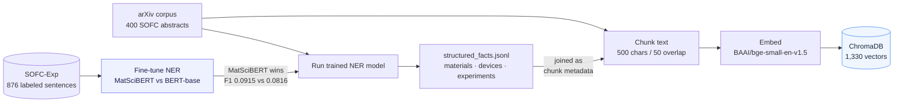
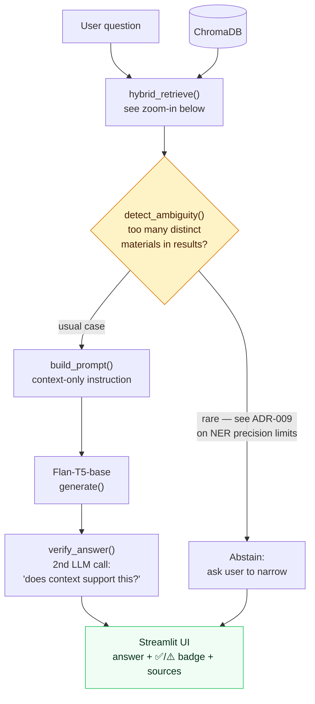
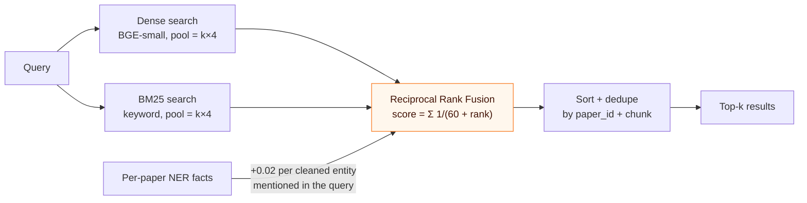
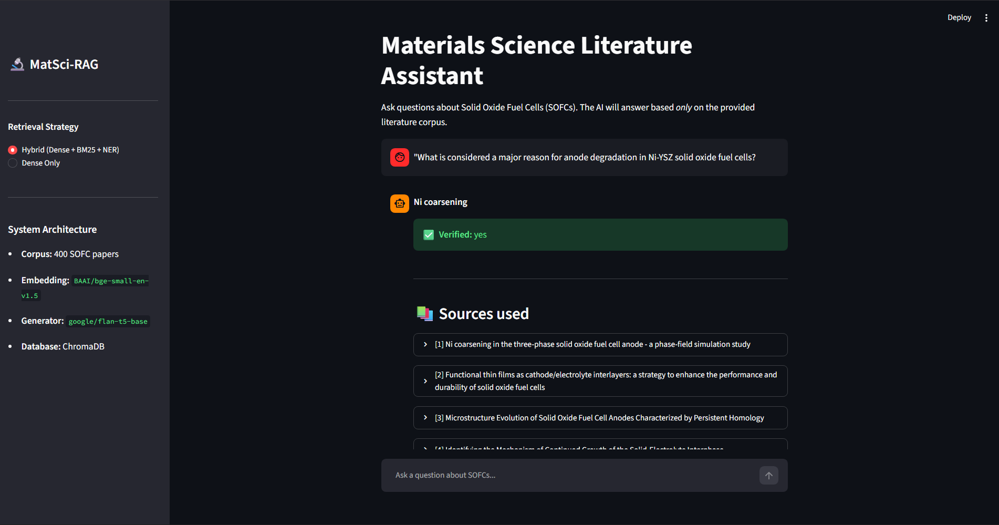
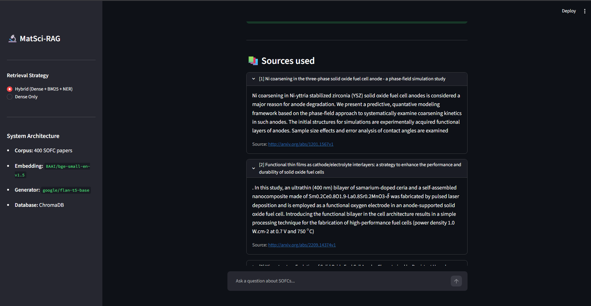

# 🔬 MatSci-RAG: Domain-Specific RAG for Materials Science

[](.python-version)
[](LICENSE)
[](https://docs.astral.sh/uv/)
[](https://docs.astral.sh/ruff/)
[](https://github.com/Mahakisore7/MatSci-RAG/actions/workflows/ci.yml)

A complete, end-to-end Retrieval-Augmented Generation (RAG) system built for Materials Science literature, focusing on Solid Oxide Fuel Cells (SOFCs).

It demonstrates how to upgrade a "generic" RAG pipeline into a **Domain-Specific NER-RAG** system using a custom-trained MatSciBERT model to extract material entities and use them to intelligently search a literature corpus.

**Contents:** [Status](#-project-status-v100--complete) · [Setup & Run](#-setup--run) · [Architecture](#-architecture) · [Key Results](#-key-results) · [Screenshots](#-screenshots) · [Project Structure](#-project-structure) · [Documentation](#-documentation)

---

## 🚀 Project Status: v1.0.0 — Complete

All 9 phases (0–8) are implemented, tested, and committed.

| Phase | What Was Built | Status |
|---|---|---|
| 0 | Environment setup: `uv`, `ruff`, pre-commit, logging, CI | ✅ |
| 1 | Data ingestion: 400 SOFC abstracts scraped from ArXiv | ✅ |
| 2 | NER training: MatSciBERT fine-tuned on SOFC-Exp corpus | ✅ |
| 3 | NER inference: structured facts extracted from 400 papers | ✅ |
| 4 | Vector indexing: 1,330 chunks embedded into ChromaDB | ✅ |
| 5 | RAG generation: grounded answers via `google/flan-t5-base` | ✅ |
| 6 | Evaluation: retrieval hit-rate measured on 20 test questions | ✅ |
| 7 | Streamlit UI + GitHub Actions CI | ✅ |
| 8 | Hybrid retrieval (BM25), self-verification, uncertainty abstention | ✅ |

---

## 🛠️ Setup & Run

### Prerequisites
- Python 3.13
- [`uv`](https://docs.astral.sh/uv/) package manager

### Install
```bash
git clone https://github.com/Mahakisore7/MatSci-RAG.git
cd MatSci-RAG
uv sync
```

### Run the Chat UI
```bash
uv run streamlit run app.py
```
Opens at `http://localhost:8501`. Use the sidebar to toggle between **Hybrid** (Phase 8) and **Dense Only** (Phase 5) retrieval.

### Run Tests
```bash
uv run pytest tests/ -v
```
All 20 tests pass locally (with `data/`/`models/` populated). In CI, 10 pure-logic unit tests
always run; the 10 that depend on local data/model artifacts skip cleanly instead of failing.

---

## 🏗️ Architecture

The system has two halves that run at different times: an **offline indexing pipeline** (run once,
whenever the corpus changes) and a **live query pipeline** (run on every question). Both use the
same NER facts, extracted once in Phase 3.

### Offline: Corpus → NER Facts → Vector Index



### Live: Question → Grounded, Verified Answer



### Zoom-in: `hybrid_retrieve()` — Why It's NER-*Aware*, Not NER-*Gated*

An earlier version hard-filtered dense search to papers whose NER tags matched certain keywords —
which sounds reasonable until you check the data: 68% of papers have no extracted `devices` field
at all, so a hard filter would silently discard most of the corpus on every query. ADR-009 replaced
it with a **soft boost** that can improve ranking but never zero out results:



*Full derivation, the `$contains`-operator bug it replaced, and the 68%-empty-field evidence are in*
*[ADR-009](docs/ADRs/ADR-009-ner-aware-retrieval-reranking.md).*

---

## 📊 Key Results

| Metric | Result |
|---|---|
| MatSciBERT NER F1 | **Higher than BERT baseline** (see [RESULTS.md](RESULTS.md)) |
| RAG retrieval hit-rate (20 questions) | **100% — correct paper in top-5 every time** |
| Flan-T5 guardrails | Refuses off-topic questions ("Who won the Super Bowl?") |
| Phase 8 live test — anode degradation query | ✅ **"Ni coarsening is considered a major reason..."** |
| Phase 8 live test — vague electrolyte query | ✅ **"I don't know based on the given context"** (correct refusal) |

Full benchmark data → **[RESULTS.md](RESULTS.md)**

---

## 🖼️ Screenshots

**Anode-degradation query, Hybrid retrieval — grounded answer, self-verified, with expandable sources:**





**The same query, two retrieval strategies — this is the Phase 8 hybrid-retrieval improvement (ADR-009) actually happening live, not just measured in the background:**

*"Which cathode materials show high oxygen reduction activity?" under* **Dense Only** *— the known failure mode (RESULTS.md, Phase 5): retrieval pulls an off-domain battery-cathode paper, and the model answers from it:*


*The identical question under* **Hybrid (Dense + BM25 + NER)** *— retrieval now surfaces the genuinely relevant SOFC paper, and the answer changes accordingly:*


---

## 📁 Project Structure

```
MatSci-RAG/
├── app.py                          ← Streamlit chat UI (entry point)
├── src/
│   ├── core/
│   │   ├── config.py
│   │   └── logging_config.py
│   ├── ingestion/
│   │   └── fetch_corpus.py
│   ├── ner/
│   │   ├── prepare_ner_data.py
│   │   ├── train_ner.py
│   │   └── run_ner_inference.py
│   └── rag/
│       ├── build_index.py
│       ├── rag_query.py            ← core pipeline + self-verification
│       ├── ner_utils.py            ← shared NER cleaning, ambiguity check, RRF+boost reranking
│       └── hybrid_retrieval.py     ← BM25 + dense, fused via ner_utils (Phase 8 / ADR-009)
├── scripts/
│   ├── evaluate_rag.py
│   ├── quick_retrieval_test.py
│   └── verify_gpu.py
├── tests/                          ← 20 pytest tests (10 pure unit tests always run in
│                                      CI; 10 artifact-dependent ones skip cleanly without
│                                      local data/models instead of erroring)
├── data/                           ← gitignored (corpus, chroma_db, facts)
├── models/                         ← gitignored (fine-tuned weights ~400MB)
├── docs/
│   ├── ADRs/                       ← 9 Architecture Decision Records
│   ├── Phases/                     ← Step-by-step build guide (Phases 0–8)
│   ├── results/                    ← Phase-level explanation docs
│   └── sample_questions.md         ← Ready-to-paste demo questions
├── .streamlit/config.toml          ← Disables file watcher (Windows fix)
├── .github/workflows/ci.yml        ← Linting + smoke tests on every push
├── RESULTS.md                      ← Full benchmark evidence
├── pyproject.toml
└── uv.lock
```

---

## 📝 Documentation

- **[docs/MatSci-RAG-Review.md](docs/MatSci-RAG-Review.md)** — full project review: problem statement, literature review, research gap, methodology, and results, written for a mentor/committee audience
- **[RESULTS.md](RESULTS.md)** — NER F1, retrieval hit-rates, live test output, and bug table
- **[docs/ADRs/](docs/ADRs/)** — 9 Architecture Decision Records (every major technical choice)
- **[docs/sample_questions.md](docs/sample_questions.md)** — Ready-to-paste demo questions for the UI

---

> **CI Note:** GitHub Actions runs `ruff` linting and `pytest tests/ -v` on every push. `data/` and `models/` are gitignored (fine-tuned weights are ~400MB–1.7GB and corpus/index files are locally generated), so the 10 tests that depend on those artifacts (NER training/inference, retrieval, generation) skip cleanly on a fresh checkout via `pytest.mark.skipif`, rather than failing. The 10 tests in `tests/test_ner_utils.py` are pure-logic unit tests with no such dependency and always run.
