<div align="center">

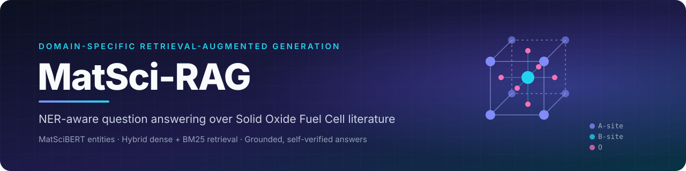

<br/>

<p>
Ask a question about SOFC materials and get an answer grounded <b>only</b> in 400 arXiv papers —<br/>
with the passages it came from, a self-verification check, and an explicit <i>"I don't know"</i> when the literature is silent.
</p>

<p>
<a href="https://github.com/Mahakisore7/MatSci-RAG/actions/workflows/ci.yml"></a>


<a href="LICENSE"></a>
</p>

<p>


</p>

<p>
<a href="#overview"><b>Overview</b></a> &nbsp;·&nbsp;
<a href="#architecture"><b>Architecture</b></a> &nbsp;·&nbsp;
<a href="#quickstart"><b>Quickstart</b></a> &nbsp;·&nbsp;
<a href="#rest-api"><b>REST API</b></a> &nbsp;·&nbsp;
<a href="#results"><b>Results</b></a> &nbsp;·&nbsp;
<a href="#findings"><b>Findings</b></a> &nbsp;·&nbsp;
<a href="#roadmap"><b>Roadmap</b></a> &nbsp;·&nbsp;
<a href="#documentation"><b>Docs</b></a>
</p>

</div>

---

<a name="overview"></a>

##  Overview

General-purpose RAG treats a materials-science paper like any other text: it embeds chunks and
retrieves by similarity. That breaks on this domain — *"cathode materials"* pulls in battery
papers, and chemical formulas like `La0.6Sr0.4Co0.2Fe0.8O3` don't embed meaningfully.

MatSci-RAG adds a **domain layer**: a MatSciBERT model fine-tuned for materials NER extracts
materials, devices and experiments from every paper, and retrieval uses those entities to
re-rank results — without ever filtering a paper out.

| Capability | How it works |
|---|---|
| **Domain NER** | MatSciBERT fine-tuned on SOFC-Exp; beats a BERT-base baseline (F1 0.0915 vs 0.0816) |
| **Hybrid retrieval** | Dense (BGE-small) + BM25, fused with Reciprocal Rank Fusion, plus an NER-overlap boost |
| **Grounded generation** | `qwen3.8-27b` via Groq, with automatic fallback to local Flan-T5; refuses unsupported questions |
| **Self-verification** | A *different* model (`gpt-oss-20b`) checks the answer against the passages and quotes its evidence |
| **Ambiguity abstention** | Asks the user to narrow the question when results span too many materials |
| **Multi-turn memory** | Follow-ups resolve pronouns from the last 3 turns |
| **Query expansion** | Optional LLM rewrite into a keyword-rich search query (retrieval only) |
| **Full-paper ingestion** | PDF download → section parsing → section-aware chunking |
| **Knowledge graph** | Interactive paper ↔ entity graph |
| **LLM-as-judge evaluation** | Faithfulness / Answer Relevancy / Context Precision, reproducible from one script |
| **REST API** | FastAPI with validated schemas and Swagger docs |

<p align="center">
  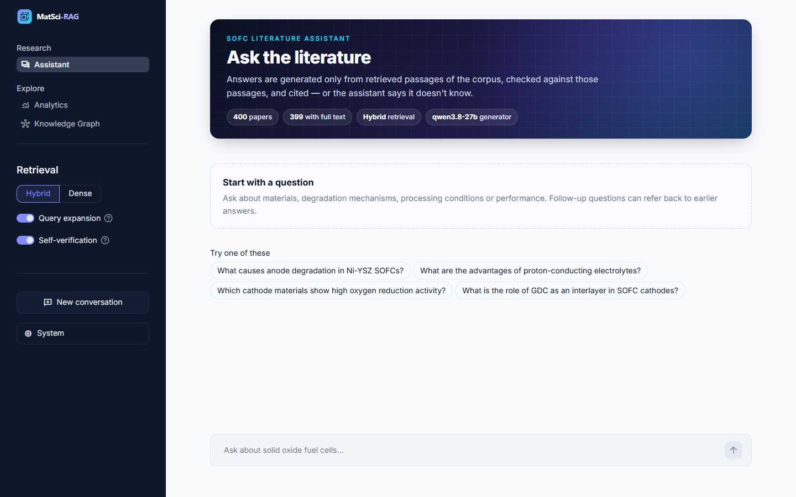
</p>

---

<a name="architecture"></a>

##  Architecture

### System overview

Two halves run at different times: an **offline pipeline** that builds the knowledge base once,
and an **online pipeline** that answers every question. Both share the same NER facts.

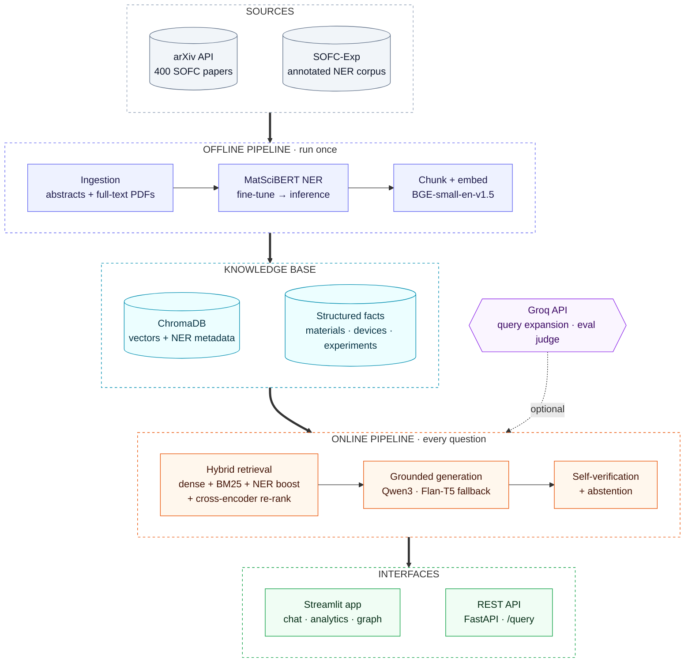

### Offline: building the knowledge base

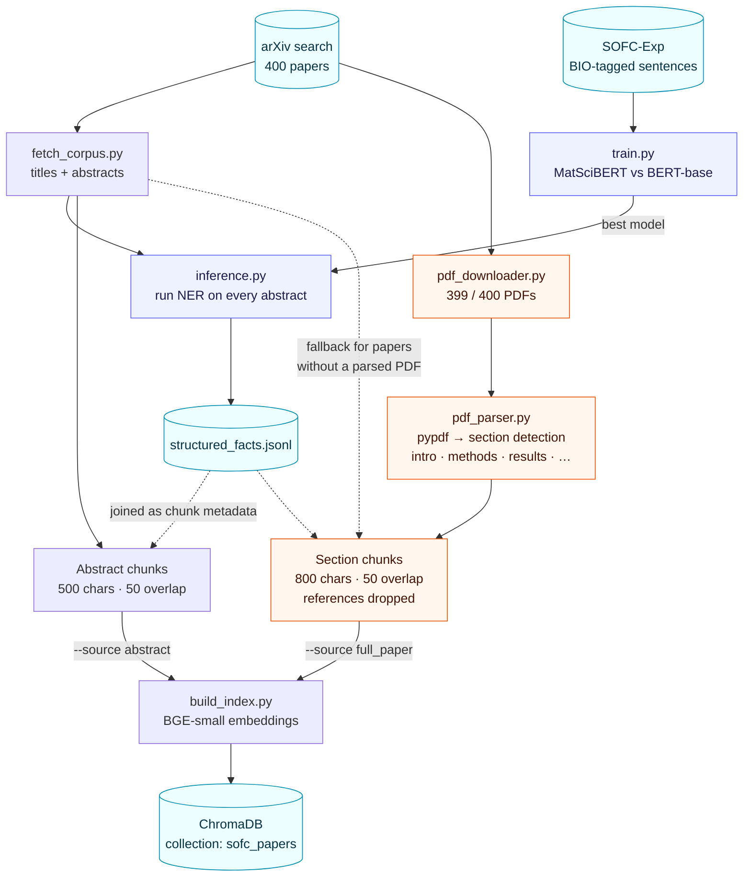

The index is built from **either** abstracts **or** full-text sections. Rebuilding always
replaces the collection — it never merges the two.

### Online: answering a question

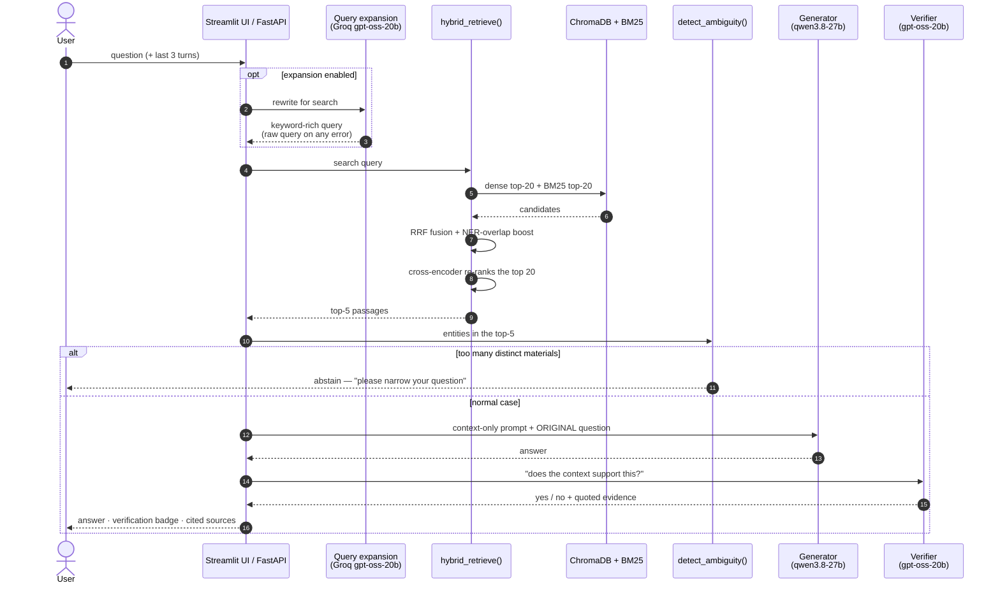

Expansion changes only **what is searched for**; the generator always sees the user's original
question, so a bad rewrite can't put words in the answer.

### Zoom-in: why retrieval is NER-*aware*, not NER-*gated*

An early version hard-filtered results by NER tags. The data showed why that fails: **68% of
papers have no extracted `devices` at all**, so a filter silently discarded most of the corpus.
The current design uses entities only as a **soft boost**:

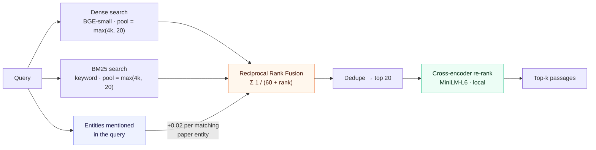

A paper with no extracted entities can still rank first on text alone; entities can only lift
relevant papers, never remove one. Derivation in [ADR-009](docs/ADRs/ADR-009-ner-aware-retrieval-reranking.md).

A cross-encoder then re-scores the fused top 20 by reading each query–passage pair together, which
the first stage cannot do ([ADR-019](docs/ADRs/ADR-019-cross-encoder-reranking.md)). On 21 questions
with known answering papers it raised hit@5 from 0.714 to 0.952 and MRR from 0.448 to 0.849, for
about +100 ms per query.

### Evaluation harness

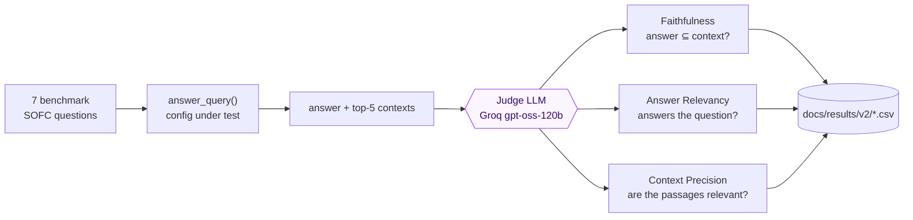

Transient API errors are retried with backoff; any other judge failure **aborts the run**
instead of being recorded as a score (see [Findings](#findings) for why).

---

<a name="quickstart"></a>

##  Quickstart

**Prerequisites:** Python 3.13, [`uv`](https://docs.astral.sh/uv/), and optionally a free
[Groq API key](https://console.groq.com/) for query expansion and evaluation.

```bash
git clone https://github.com/Mahakisore7/MatSci-RAG.git
cd MatSci-RAG
uv sync
cp .env.example .env          # add GROQ_API_KEY (optional)
```

**Build the knowledge base** (one-time; `data/` and `models/` are gitignored):

```bash
# 1. Corpus: 400 SOFC abstracts from arXiv
uv run python -m src.ingestion.fetch_corpus \
    --query "solid oxide fuel cell SOFC electrolyte anode cathode material" \
    --output data/sofc_corpus.jsonl

# 2. NER training data: Bosch's SOFC-Exp corpus (follow its README to fetch the texts)
git clone https://github.com/boschresearch/sofc-exp_textmining_resources.git data/sofc_exp_repo
uv run python -m src.ner.prepare_data                 # → data/ner_processed

# 3. Fine-tune MatSciBERT + BERT-base baseline, then tag every paper
uv run python -m src.ner.train                        # GPU recommended
uv run python -m src.ner.inference                    # → data/structured_facts.jsonl

# 4. Vector index — abstracts (default) or full text
uv run python -m src.rag.build_index
uv run python scripts/ingest_full_papers.py           # optional: download, parse, re-index
```

**Run it:**

```bash
uv run streamlit run src/ui/app.py                    # chat UI → http://localhost:8501
uv run uvicorn src.api.main:app --port 8000           # REST API → http://localhost:8000/docs
uv run pytest tests/ -v                               # test suite
uv run python scripts/evaluate_ragas.py --expand      # LLM-judge evaluation
```

### Configuration

All settings live in [`src/core/config.py`](src/core/config.py) and can be overridden with
environment variables (or `.env`):

| Variable | Default | Purpose |
|---|---|---|
| `GEN_BACKEND` | `groq` | `groq` = hosted model with local fallback; `local` = fully offline |
| `GROQ_GEN_MODEL` | `qwen/qwen3.8-27b` | Answer generator |
| `GROQ_VERIFY_MODEL` | `openai/gpt-oss-20b` | Self-verification (deliberately a different model) |
| `GEN_MODEL_NAME` | `google/flan-t5-base` | Local generator, and the fallback when Groq is unavailable |
| `USE_RERANK` | `1` | Cross-encoder re-ranking of retrieved passages; `0` disables it |
| `RERANK_MODEL` | `cross-encoder/ms-marco-MiniLM-L-6-v2` | Local cross-encoder used for re-ranking |
| `GROQ_API_KEY` | — | Enables query expansion and evaluation |
| `GROQ_EXPANSION_MODEL` | `openai/gpt-oss-20b` | Query rewriting (fast; on the live path) |
| `GROQ_JUDGE_MODEL` | `openai/gpt-oss-120b` | Evaluation judge |
| `HF_TOKEN` | — | Hugging Face downloads (optional) |

Generator, verifier and judge are three different models, so no model grades its own output.
Groq has retired several models this project used, so model names are configuration, not code.

---

<a name="rest-api"></a>

##  REST API

```bash
curl -X POST http://localhost:8000/query \
  -H "Content-Type: application/json" \
  -d '{"question": "What causes anode degradation in Ni-YSZ SOFCs?", "expand_query": true}'
```

```jsonc
{
  "answer": "Based on the provided context, anode degradation in Ni-YSZ SOFCs is primarily caused by **Ni coarsening**. This is a capillarity-driven phenomenon where materials are transported from regions of high curvature to regions of lower curvature (in accordance with the Gibbs-Thomson effect). This process increases the resistance in SOFCs and results in cell degradation. Additionally, high operating temperatures contribute to rapid component degradation.",
  "abstained": false,
  "verification": "Yes.  \n“Ni coarsening in the SOFC anode is a capillarity‑driven phenomenon. Regions with high curvatures have higher chemical potentials than those with lower curvatures in accordance with the Gibbs‑Thomson effect. Materials will therefore be transported from higher‑to‑lower‑curvature regions when mobility is sufficiently large for the time scale of interest.” (Context [4])",
  "sources": [
    // 5 passages; the one the verifier cites is shown
    {
      "rank": 4,
      "title": "Ni coarsening in the three-phase solid oxide fuel cell anode - a phase-field simulation study",
      "paper_id": "http://arxiv.org/abs/1201.1567v1",
      "section": "introduction",
      "text": "major mechanisms responsible for microstructural change i n SOFC anodes [10]. …"
    }
  ]
}
```

This is real output from `qwen3.8-27b`: the answer is grounded in the retrieved passages, and
the verifier (a different model) quotes the exact supporting sentence.

| Field | Type | Default | Notes |
|---|---|---|---|
| `question` | string | — | 1–1000 characters |
| `use_hybrid` | bool | `true` | `false` = dense-only retrieval |
| `expand_query` | bool | `false` | LLM rewrite before retrieval |
| `verify` | bool | `true` | Run the self-verification check |
| `chat_history` | list | `[]` | `{role: "user" \| "assistant", content}`, max 20 |

`GET /health` returns the active generator. Interactive docs are at `/docs`. Design notes in
[ADR-014](docs/ADRs/ADR-014-rest-api.md).

---

<a name="results"></a>

##  Results

### NER: domain pretraining helps

| Model | Test F1 |
|---|---|
| BERT-base | 0.0816 |
| **MatSciBERT** | **0.0915** |

Absolute F1 is low because the training set is small (SOFC-Exp) and most tokens are non-entities;
the comparison between the two models is the point. Details in [RESULTS.md](RESULTS.md).

### Retrieval

| Test | Result |
|---|---|
| Dense retrieval hit-rate, 20 specific questions | **100% (20/20)** correct paper in top-5 |
| *"Which cathode materials show high ORR activity?"* | Dense-only returns a battery paper; hybrid returns the SOFC paper ([screenshots](#screenshots)) |

### End-to-end quality (LLM judge, 7 questions)

Ten configurations, the same 7 benchmark questions, judged by `openai/gpt-oss-120b`
([raw CSVs](docs/results/v2/); analysis in [ADR-015](docs/ADRs/ADR-015-generator-size-and-full-corpus-evaluation.md)
and [ADR-016](docs/ADRs/ADR-016-groq-generator-with-local-fallback.md)):

| Index | Generator | Expansion | Faithfulness | Answer Relevancy | Context Precision |
|---|---|:---:|---:|---:|---:|
| Abstracts | flan-t5-base | | 0.857 | 0.000 | 0.314 |
| Abstracts | flan-t5-base | on | 0.857 | **0.143** | 0.486 |
| Abstracts | flan-t5-large | | 0.857 | 0.000 | 0.343 |
| Abstracts | flan-t5-large | on | 0.857 | 0.071 | 0.457 |
| Full text | flan-t5-base | | 0.857 | 0.071 | **0.586** |
| Full text | flan-t5-base | on | 0.857 | 0.000 | 0.571 |
| Full text | flan-t5-large | | 0.714 | 0.000 | **0.586** |
| Full text | flan-t5-large | on | 0.857 | 0.000 | 0.543 |
| Full text | qwen3.8-27b | | **1.000** | 0.429 | 0.543 |
| **Full text** | **qwen3.8-27b** | **on** | 0.857 | **0.714** | 0.543 |

**Bold row = the configuration the app serves by default.** Context Precision depends only on
retrieval, so the spread between generators on the same index (0.314 vs 0.343) shows the judge's
noise: about ±0.03.

<p align="center">
  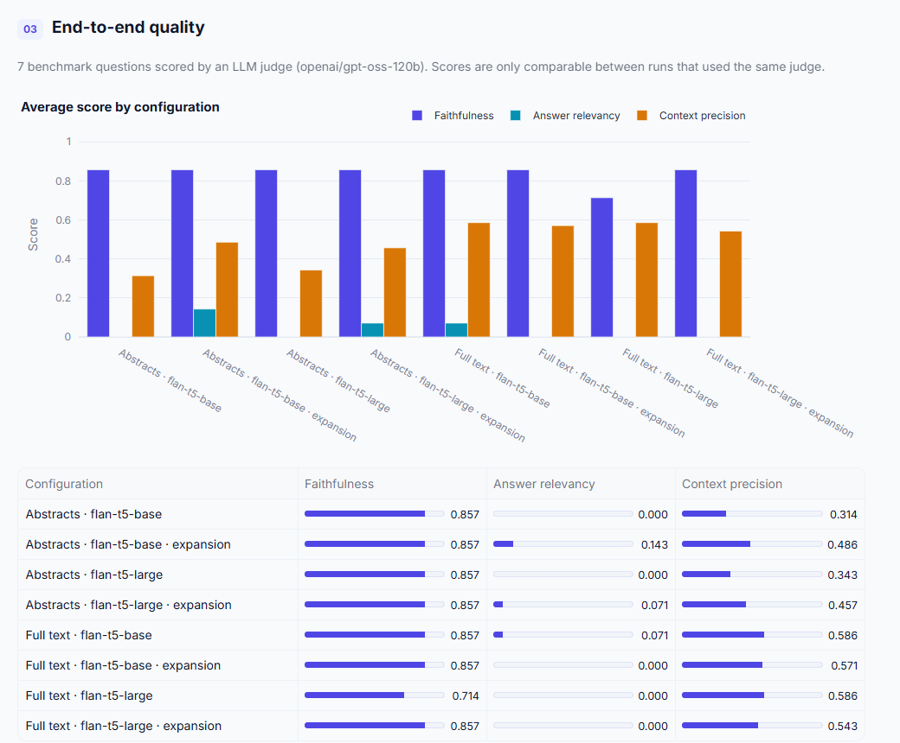
</p>

---

<a name="findings"></a>

##  Findings & Limitations

These are measured, not assumed — each has evidence in [RESULTS.md](RESULTS.md).

**1 · Generation was the bottleneck — and a stronger model fixed it.** Full text nearly doubled
Context Precision (0.314 → 0.586), yet with Flan-T5 Answer Relevancy stayed near zero in every
configuration; `flan-t5-large` only became more cautious. Swapping in `qwen3.8-27b` on the same
retrieval raised Answer Relevancy **0.071 → 0.429**, and to **0.714** with query expansion,
with Faithfulness unchanged or better. Retrieval had been finding the right passages all along.

<table>
<tr>
<td width="50%" valign="top"><b>Before</b> — flan-t5-base: the answer is in passage 2, the model answers from passage 1, and the same-model verifier approves it.<br/><br/>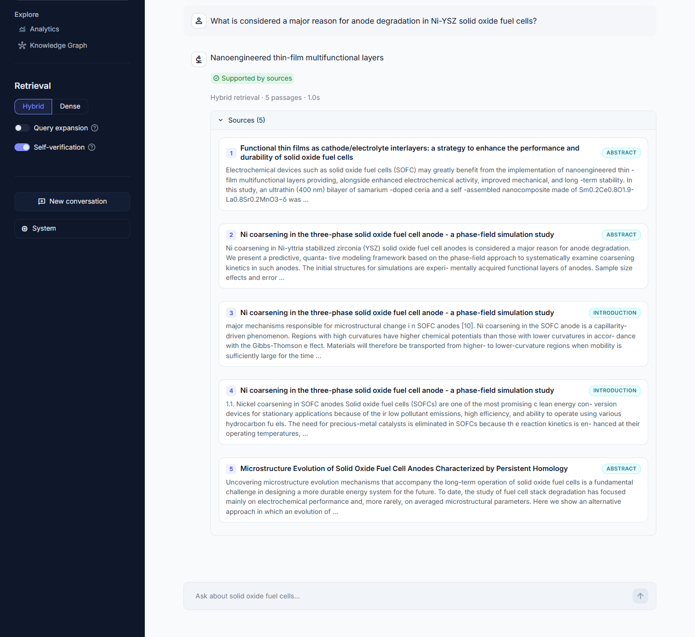</td>
<td width="50%" valign="top"><b>After</b> — qwen3.8-27b: a correct, grounded answer; a different verifier model quotes the supporting sentence.<br/><br/></td>
</tr>
</table>

**2 · A verifier is only as good as its model.** With Flan-T5 checking its own output, the
self-check approved a wrong answer. It now runs on a separate model (`gpt-oss-20b`) and must quote
its evidence, so a "supported" badge can be checked by a human in seconds.

**3 · Query expansion's value depends on the generator.** It raises Context Precision on abstracts
(0.314 → 0.486) but not on full text. With Qwen it still lifts Answer Relevancy (0.429 → 0.714),
because the rewritten query pulls in passages a capable model can synthesize — so it is now on by
default in the app.

**4 · Silent failures were the biggest engineering risk.** Each of these looked healthy from
the outside: PDF downloads failed for 100% of papers (wrong `arxiv` API); the retired judge
model's 404s were recorded as 0.0 scores; query expansion silently fell back to the raw query
for the same reason; and the chat UI could not import its own package after a restructure.
All are fixed, and the evaluator now **aborts** rather than invent a score.

**5 · The corpus is noisy, but noise isn't what limits it.** Only 145 of the 400 "SOFC" papers
mention a fuel-cell technology. Indexing just those 145 (3× fewer vectors) gave no measurable gain
and was slightly worse with expansion ([ADR-017](docs/ADRs/ADR-017-fuel-cell-corpus-filter.md)):
the questions that fail, fail on both indexes. The filter remains available as
`build_index --fuel-cell-only`.

**6 · NER is useful but imprecise.** Test F1 is 0.09, and most papers have no extracted device
entity (68% raw, 78% after noise filtering) — which is exactly why entities re-rank results
instead of filtering them (ADR-009).

**7 · The benchmark is small.** Seven questions detect large effects (like finding 1), not
differences of a few hundredths. Three of the seven still get *"I don't know"*. A 28-question follow-up
([ADR-018](docs/ADRs/ADR-018-larger-benchmark-and-retrieval-diagnosis.md)) found 11 abstentions
and, in 4 of 5 cases checked, an on-topic paper already in the corpus that retrieval ranked
outside the top 5. The limit is ranking, not coverage, and cross-encoder
re-ranking ([ADR-019](docs/ADRs/ADR-019-cross-encoder-reranking.md)) now closes most of that gap.

**8 · The answer path now depends on an API.** If Groq is down or rate-limited, answers fall
back to local Flan-T5 automatically, so the app keeps working, but with the weaker model.

---

<a name="roadmap"></a>

##  Roadmap

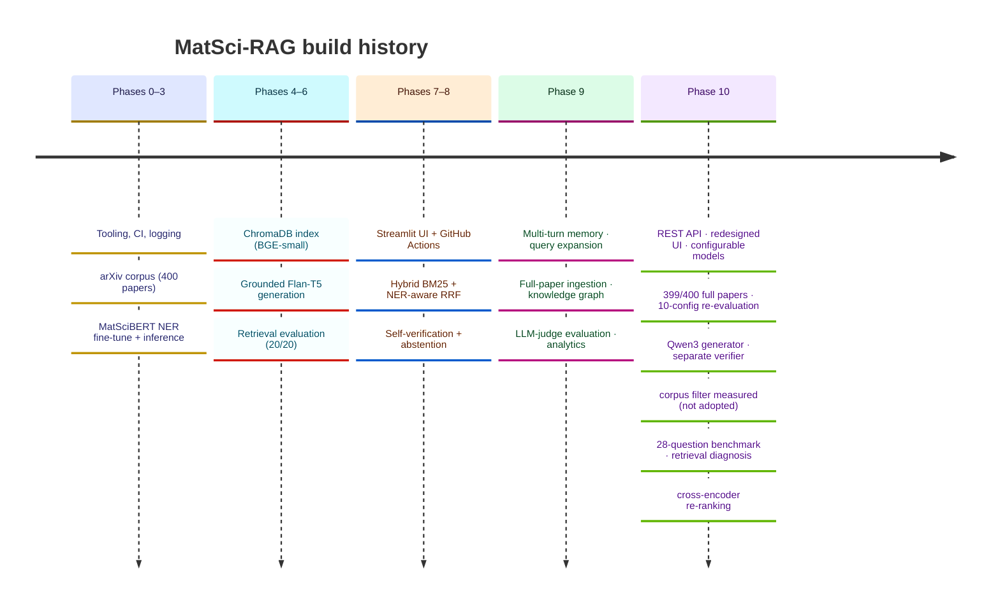

**Next steps**, in order of expected impact:

1. **Judged end-to-end run with re-ranking.** Re-ranking is built and lifts retrieval hit@5 from
   0.714 to 0.952 (ADR-019), but its effect on Answer Relevancy has not been judged yet: a
   28-question run needs most of Groq's 200,000-token daily judge budget. Run it with `--resume`.
   Also try a larger candidate pool and a larger cross-encoder.
2. **Held-out benchmark** — the 28-question set (`--benchmark v2`) was written by the system's
   author; questions from someone else would be a stronger test.
3. **Better PDF extraction** (layout-aware parsing) — `pypdf` text carries broken words and
   equation fragments into full-paper chunks.
4. **A local strong generator** (e.g. a 7–8B model) as an offline-capable alternative to Groq.

---

<a name="screenshots"></a>

##  Screenshots

**Assistant** — example questions to start, retrieval and verification controls in the sidebar:


**Analytics** — corpus coverage, extracted entities and every evaluation run:

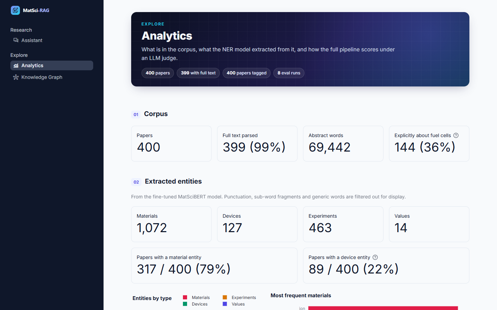

**Knowledge graph** — papers linked to the materials, devices and experiments extracted from them:

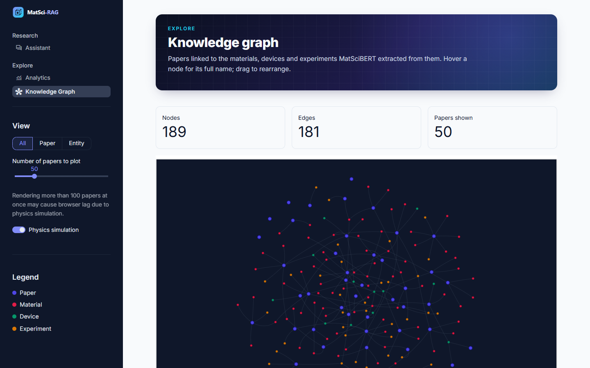

<details>
<summary><b>Dense vs hybrid retrieval on the same question</b> (captured with the Phase 8 UI)</summary>
<br/>

*Dense only* pulls an off-domain battery paper and answers FePO₄:

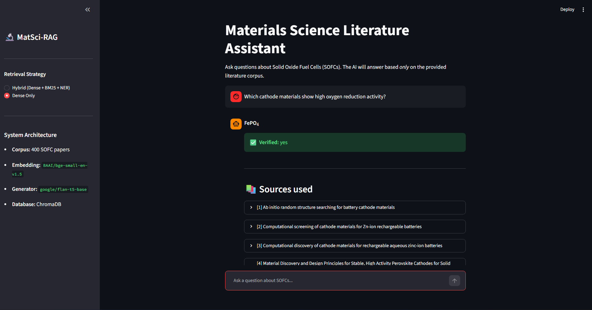

*Hybrid (dense + BM25 + NER)* surfaces the SOFC paper instead:

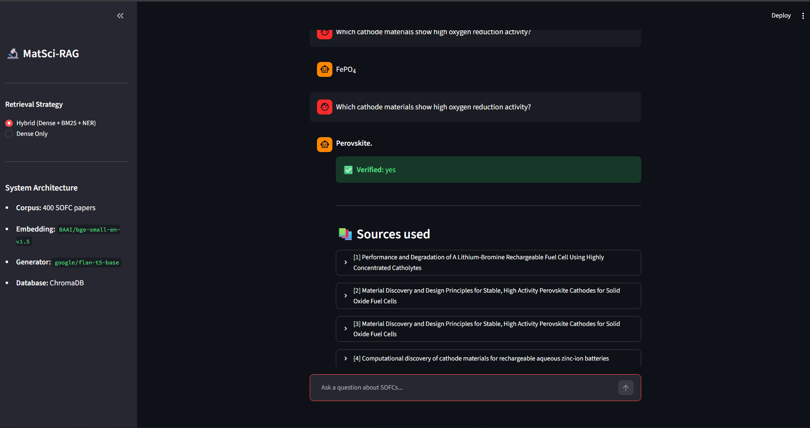

</details>

---

<a name="tech-stack"></a>

##  Tech Stack

| Layer | Stack |
|---|---|
| **NER** |    |
| **Retrieval** |     |
| **Generation** |   |
| **LLM services** |    |
| **Ingestion** |    |
| **Interfaces** |      |
| **Engineering** |      |

---

<a name="project-structure"></a>

##  Project Structure

```
MatSci-RAG/
├── src/
│   ├── core/                 config.py (all tunable settings) · logging_config.py
│   ├── ingestion/            fetch_corpus.py · pdf_downloader.py · pdf_parser.py
│   ├── ner/                  prepare_data.py · train.py · inference.py
│   ├── rag/
│   │   ├── build_index.py        abstract or full-paper index (with abstract fallback)
│   │   ├── hybrid_retrieval.py   dense + BM25 candidate pools
│   │   ├── rerank.py             cross-encoder re-ranking · per-paper cap
│   │   ├── ner_utils.py          entity cleaning · RRF + NER boost · ambiguity check
│   │   ├── query_expansion.py    Groq query rewriting
│   │   └── rag_query.py          answer_query() · verify_answer()
│   ├── api/main.py           FastAPI: POST /query, GET /health
│   └── ui/                   app.py (router) · theme.py · views/{chat, analytics, knowledge_graph}.py
├── scripts/                  evaluate_ragas.py · evaluate_rag.py · ingest_full_papers.py
├── tests/                    60 tests — 51 run everywhere (incl. CI); 9 that need local
│                             data/models skip cleanly on a fresh checkout
├── docs/
│   ├── ADRs/                 19 Architecture Decision Records
│   ├── Phases/               step-by-step build guide, Phases 0–8
│   ├── results/              evaluation CSVs (v2/ = current judge) and logs
│   ├── Complete-Guide.md     the whole project in one document, all diagrams
│   ├── PPT-Source.md         slide-by-slide source for a presentation
│   ├── MatSci-RAG-Review.md  formal project review
│   └── Project-Explainer.md  glossary, full flow, mentor Q&A
├── data/  models/            gitignored — generated by the offline pipeline
└── RESULTS.md                all benchmark evidence
```

---

<a name="documentation"></a>

##  Documentation

| Document | What's in it |
|---|---|
| [RESULTS.md](RESULTS.md) | Every measurement: NER F1, retrieval hit-rate, eval tables, bugs found |
| [docs/MatSci-RAG-Review.md](docs/MatSci-RAG-Review.md) | Problem statement, literature review, methodology, results |
| [docs/Complete-Guide.md](docs/Complete-Guide.md) | The whole project in one document: every architecture diagram, all results, the investigation story, limits and what is pending |
| [docs/PPT-Source.md](docs/PPT-Source.md) | Slide-by-slide source for a presentation: on-slide text, visuals, speaker notes, backup slides |
| [docs/Project-Explainer.md](docs/Project-Explainer.md) | Glossary of every term, a fully traced example, mentor Q&A |
| [docs/ADRs/](docs/ADRs/) | 19 decision records — why each technical choice was made |
| [docs/sample_questions.md](docs/sample_questions.md) | Ready-to-paste demo questions |
| [docs/archive/](docs/archive/) | Base paper (Maharana et al., 2025) and the Zeroth Review |

---

<div align="center">
<sub>Licensed under [Apache 2.0](LICENSE) · Built with `uv`, tested with `pytest`, checked by GitHub Actions</sub>
</div>
