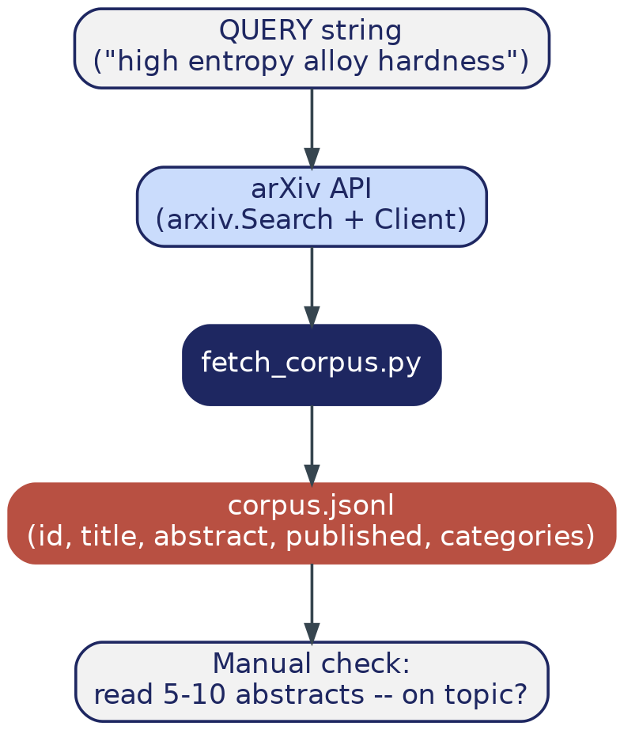

# Phase 1 — Data Collection: Build the Corpus

> **Where this file lives:** `docs/build-guide/01_data_collection.md`
> **Diagram referenced below lives at:** `docs/build-guide/diagrams/phase1_flow.png`

---

## 1. Overview — What This Phase Is and Why It Exists

Every layer of this project — NER extraction, embedding, retrieval, generation — operates on one thing: real materials science text. Before any of that can be built, you need an actual, on-topic collection of documents sitting on disk. That's the entire job of this phase: nothing clever yet, just a clean, verified, reproducible corpus.

This matters more than it sounds like it should. A bad corpus (too broad, off-topic, too small) silently caps the quality of *everything* built on top of it later — a perfect RAG pipeline retrieving irrelevant passages is still a broken system. So this phase's real deliverable isn't just "a script that hits an API" — it's a corpus you have personally verified is actually about what you think it's about.

By the end of this phase you will have:

- A script (`src/fetch_corpus.py`) that queries the arXiv API for a topic you choose
- `data/corpus.jsonl` — 300-500 real abstracts, one JSON object per line
- A test that fails loudly if the corpus is ever empty or malformed
- Your own manual confirmation (not just an automated check) that the abstracts are on-topic

---

## 2. Phase Data Flow



A straight line, deliberately: topic query → arXiv's public API → your script → one output file → a check only you can do (reading it). Nothing in Phases 2 onward can compensate for a corpus that's off-topic at this stage — this is why the last box in the diagram is a manual step, not another script.

---

## 3. File Structure — Before and After This Phase

### Before (end of Phase 0):
```
MatSci-RAG/
├── src/
│   ├── config.py
│   └── logging_config.py
├── tests/                  (empty)
├── data/                   (empty)
├── models/                 (empty)
├── .github/workflows/ci.yml
├── pyproject.toml
├── uv.lock
└── ... (docs/, .env, etc.)
```

### After this phase:
```
MatSci-RAG/
├── src/
│   ├── config.py
│   ├── logging_config.py
│   └── fetch_corpus.py         <- NEW
├── tests/
│   └── test_fetch_corpus.py    <- NEW
├── data/
│   └── corpus.jsonl            <- NEW (generated, gitignored)
├── models/                     (still empty until Phase 2)
└── ... (everything else unchanged)
```

Only one new source file, one new test file, one generated data file. Small, verifiable, and it should stay that way — resist the urge to add anything else in this phase.

---

## 4. Git Versioning for This Phase

```bash
git checkout main
git pull
git checkout -b phase-1-data-collection
```

**Commit type for this phase:** `feat:` — this is new functionality (a working corpus-fetching capability), not just tooling.

**Tag on completion:** `v0.2.0`

---

## 5. Step-by-Step Implementation

### 5.1 Choose your topic query — this decision matters more than the code

Two options were discussed earlier in scoping this project: **"high entropy alloy"** or **"solid state hydrogen storage"** (the latter directly mirrors the base paper, Maharana et al. 2025). Pick one now — don't leave it undecided, since Phase 2's NER labeling and Phase 6's test questions will all be written assuming a specific topic.

### 5.2 Create `src/fetch_corpus.py`

*(Full code — this phase has no ambiguity requiring an IDE agent; the arXiv API's interface is small and fully specified.)*

```python
# src/fetch_corpus.py
"""Fetches materials-science abstracts from the arXiv API and saves them as
JSONL. This is the ONLY entry point into the whole project's data -- every
later phase reads from data/corpus.jsonl and nowhere else."""

import arxiv
import json
import os
from logging_config import get_logger

log = get_logger(__name__)

# Pick your topic here -- see Section 5.1 above before changing this.
QUERY = "high entropy alloy hardness"
MAX_RESULTS = 400
OUTPUT_PATH = "data/corpus.jsonl"

def fetch_corpus(query: str, max_results: int, output_path: str) -> int:
    """Fetch abstracts from arXiv matching `query` and save as JSONL.

    Returns the number of records saved.
    """
    search = arxiv.Search(
        query=query,
        max_results=max_results,
        sort_by=arxiv.SortCriterion.Relevance,
    )
    client = arxiv.Client()

    os.makedirs(os.path.dirname(output_path), exist_ok=True)
    count = 0
    with open(output_path, "w", encoding="utf-8") as f:
        for result in client.results(search):
            record = {
                "id": result.entry_id,
                "title": result.title,
                "abstract": result.summary.replace("\n", " ").strip(),
                "published": str(result.published),
                "categories": result.categories,
            }
            f.write(json.dumps(record) + "\n")
            count += 1

    log.info(f"Saved {count} abstracts to {output_path}")
    return count

if __name__ == "__main__":
    fetch_corpus(QUERY, MAX_RESULTS, OUTPUT_PATH)
```

**Why every field is there:**
- `id` — the arXiv URL, used as the unique identifier threaded through every later phase (structured facts, FAISS passages, evaluation test cases all key off this)
- `title` + `abstract` — the actual content
- `published` — lets you later filter/sort by recency if you want
- `categories` — arXiv's own subject tags (e.g., `cond-mat.mtrl-sci`), useful for a sanity check that you're actually pulling from the right subject area

### 5.3 Run it

```bash
uv run src/fetch_corpus.py
```

### 5.4 Verify — the manual step the diagram calls out

```bash
wc -l data/corpus.jsonl
uv run python -c "import json; print(json.loads(open('data/corpus.jsonl').readline())['title'])"
```

Now actually read 5-10 full abstracts, not just titles. Ask yourself honestly: if I searched this corpus for a specific alloy property, would a relevant answer actually be in here? If the answer is no, change `QUERY` in `fetch_corpus.py` now, before writing another line of code — this is the cheapest possible point to fix it.

### 5.5 Create `tests/test_fetch_corpus.py`

*(Full code.)*

```python
# tests/test_fetch_corpus.py
import json
import os

def test_corpus_file_exists_and_has_records():
    assert os.path.exists("data/corpus.jsonl")
    with open("data/corpus.jsonl") as f:
        lines = f.readlines()
    assert len(lines) > 100   # sanity floor -- adjust to your actual MAX_RESULTS

def test_corpus_records_have_required_fields():
    with open("data/corpus.jsonl") as f:
        record = json.loads(f.readline())
    for field in ["id", "title", "abstract", "published"]:
        assert field in record
```

```bash
uv run pytest tests/test_fetch_corpus.py -v
```

**What this test does and doesn't catch:** it confirms the file exists, isn't suspiciously small, and has the right shape. It does **not** confirm the content is on-topic — that's still your job from Section 5.4, and no test can replace it here.

---

## 6. Git: Commit and Merge

```bash
git add src/fetch_corpus.py tests/test_fetch_corpus.py
git commit -m "feat: add arXiv corpus fetching script with logging and tests"

git checkout main
git merge phase-1-data-collection
git tag v0.2.0
```

*(`data/corpus.jsonl` is not committed — it's gitignored from Phase 0, since it's a regeneratable artifact, not source code.)*

---

## 7. ✅ Phase 1 Checkpoint — Do Not Proceed to Phase 2 Until All Checked

- [ ] `data/corpus.jsonl` exists with 300+ lines
- [ ] You have personally read 5-10 abstracts and confirmed they're genuinely on-topic
- [ ] `uv run pytest tests/test_fetch_corpus.py` passes
- [ ] Merged to `main`, tagged `v0.2.0`

---

## 8. Troubleshooting

| Symptom | Fix |
|---|---|
| Very few results returned | Query too narrow — broaden it (e.g., drop "hardness", just search "high entropy alloy") |
| Results look off-topic on manual read | Don't proceed — narrow or rephrase `QUERY`, re-run, re-check before moving on |
| Slow / seems rate-limited | Normal — the `arxiv` package paces requests automatically per arXiv's usage policy; just let it finish |
| `ModuleNotFoundError: No module named 'logging_config'` | Run scripts from the project root with `uv run src/fetch_corpus.py`, not from inside `src/` |

---

## 9. On Handing This to an IDE Agent

Nothing in this phase needs one — the arXiv API surface is small enough that there's no ambiguous, format-dependent step here (unlike Phase 2, where the Matscholar dataset's exact file layout genuinely can't be known until you inspect it). If you want to use Claude/Gemini in Antigravity anyway, the one place it can add real value is **helping you choose and refine the `QUERY` string** — ask it to suggest arXiv search syntax variations if your first query returns too few or too broad a set of results.

---

**Next file:** `02_ner_training.md` — request it once every box in Section 7 is checked.
