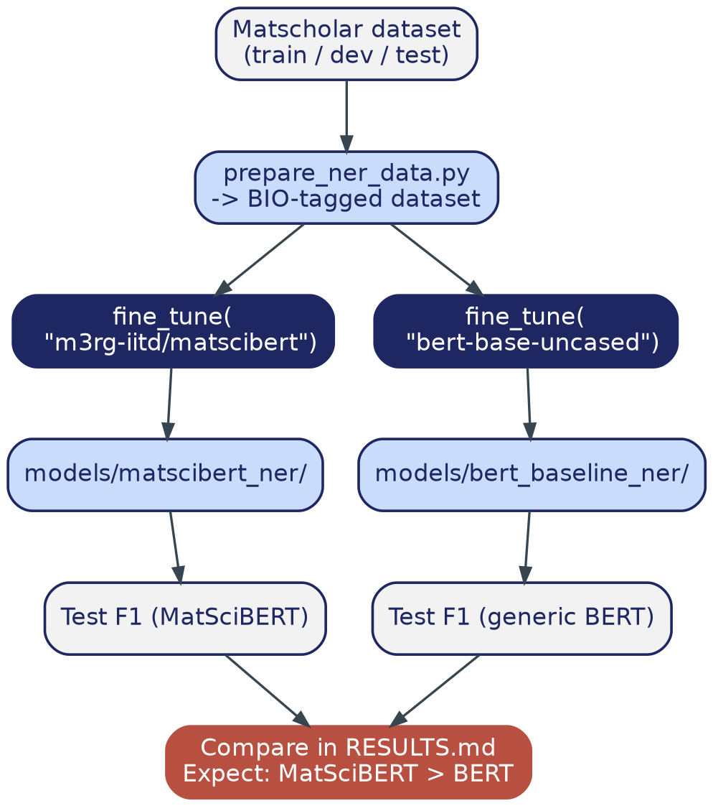

# Phase 2 — NER: Labeled Data + Fine-Tuning MatSciBERT vs. BERT

> **Where this file lives:** `docs/build-guide/02_ner_training.md`
> **Diagram referenced below lives at:** `docs/build-guide/diagrams/phase2_flow.png`

---

## 1. Overview — What This Phase Is and Why It Exists

This is the phase that produces your project's core, citable research result. Everything else in this project is architecture and engineering; this phase is the one genuine experiment: **does pretraining a language model on materials-science text before fine-tuning it actually make it better at extracting materials-science entities, compared to a generic model given the exact same fine-tuning data?**

This question isn't hypothetical — it's the direct subject of a real paper (Trewartha et al., 2022) that this phase reproduces, at smaller scale, on your own setup. That's what makes this phase worth taking seriously rather than rushing: a clean, honestly-run version of this comparison is a genuinely defensible result to show a mentor, not just "I ran some code."

By the end of this phase you will have:

- A parsed, tokenizer-ready version of the Matscholar labeled dataset
- `models/matscibert_ner/` — MatSciBERT fine-tuned on it
- `models/bert_baseline_ner/` — generic BERT fine-tuned on the *exact same* data, same procedure
- A documented entity-level F1 score for both, recorded in `RESULTS.md`
- **Expected outcome:** MatSciBERT's F1 measurably higher than generic BERT's

**Important honesty note before you start:** unlike Phases 0 and 1, this phase has one piece I genuinely cannot hand you as complete, verified code — the exact parser for the Matscholar dataset's raw file format. Section 5.2 below explains precisely why, and exactly how to close that gap yourself using an IDE agent. Everything else in this phase — the training code, the comparison logic, the metrics — is complete and ready to run as-is.

---

## 2. Phase Architecture: The Controlled Comparison



Look closely at the shape of this diagram: **one dataset, splitting into two identical training procedures**, differing only in which pretrained model each starts from. That symmetry is the entire point — it's what lets you say "the difference in F1 is caused by domain-specific pretraining" rather than "the difference in F1 is caused by *something*, possibly pretraining, possibly a dozen other confounds." Keep both branches identical (same hyperparameters, same data, same epochs) or the comparison stops being meaningful.

---

## 3. File Structure — Before and After This Phase

### Before (end of Phase 1):
```
MatSci-RAG/
├── src/
│   ├── config.py
│   ├── logging_config.py
│   └── fetch_corpus.py
├── tests/
│   └── test_fetch_corpus.py
├── data/
│   └── corpus.jsonl
├── models/                          (empty)
└── ...
```

### After this phase:
```
MatSci-RAG/
├── src/
│   ├── config.py
│   ├── logging_config.py
│   ├── fetch_corpus.py
│   ├── prepare_ner_data.py         <- NEW
│   └── train_ner.py                <- NEW
├── tests/
│   ├── test_fetch_corpus.py
│   └── test_ner_training.py        <- NEW
├── data/
│   ├── corpus.jsonl
│   ├── matscholar_repo/            <- NEW (cloned, gitignored)
│   ├── matscholar/                 <- NEW (extracted train/dev/test files)
│   └── matscholar_processed/       <- NEW (generated, gitignored)
├── models/
│   ├── matscibert_ner/             <- NEW (fine-tuned checkpoint, gitignored)
│   └── bert_baseline_ner/          <- NEW (fine-tuned checkpoint, gitignored)
├── RESULTS.md                       <- NEW (committed — this is your evidence)
└── ...
```

---

## 4. Git Versioning for This Phase

```bash
git checkout main
git pull
git checkout -b phase-2-ner-training
```

**Commit type:** `feat:` (new capability) — you may also want a separate `docs:` commit for `RESULTS.md` if you prefer to keep the result-recording distinct from the code that produced it.

**Tag on completion:** `v0.3.0`

---

## 5. Step-by-Step Implementation

### 5.1 Download the Matscholar dataset

```bash
git clone https://github.com/materialsintelligence/matscholar.git data/matscholar_repo
```

Record exactly which version you cloned — this is a production/reproducibility practice, not optional:
```bash
git -C data/matscholar_repo rev-parse HEAD
```
Paste that commit hash into your project's main `README.md` under a "Data Sources" section, right now, before you forget.

### 5.2 The one honest gap: inspect the actual file format before parsing it

**Why I can't give you a guaranteed-correct parser sight-unseen:** labeled NER datasets get distributed in several common but incompatible formats — sometimes plain CoNLL (one token+tag per line, blank line between sentences), sometimes JSON Lines with token/tag arrays per record, sometimes something dataset-specific. I know the *content* of Matscholar (7 entity types: MAT, SPL, DSC, PRO, APL, SMT, CMT; a 440/511/546 train/dev/test split) because that's documented and stable. I do **not** know with certainty which exact file layout the current repo snapshot uses, because that's an implementation detail that can change between commits and isn't something to guess at when correctness matters this much — a silently wrong parser here would invalidate your entire Phase 2 result without any error message telling you so.

**What to do — two options:**

**Option A (recommended): use an IDE agent, with real data pasted in, not a guess**

1. Locate the actual labeled files inside `data/matscholar_repo` (check the repo's own README for the path — likely something with `ner` in it).
2. Run:
   ```bash
   head -30 data/matscholar_repo/<path-to-file-you-found>
   ```
3. Paste that real output into Claude or Gemini inside Antigravity with this prompt:
   > "This is the first 30 lines of a labeled NER dataset file. Write a Python function `load_raw_split(path: str) -> list[dict]` that parses this exact format into a list of `{"tokens": [...], "tags": [...]}` dictionaries, one per sentence."
4. Drop the function it gives you into `src/prepare_ner_data.py` in place of the `load_raw_split` function below, which is a *reasonable default guess* (standard CoNLL format) but should be treated as a starting point to verify, not a guarantee.

**Option B:** if the skeleton `load_raw_split` below happens to match (many NER datasets do use plain CoNLL format), you can use it directly — just verify by printing the first parsed sentence and confirming it looks right before trusting it for training.

### 5.3 Create `src/prepare_ner_data.py`

*(Structure and logic complete; `load_raw_split`'s body is the CoNLL-format best-guess from 5.2 — verify or replace it per the instructions above before proceeding.)*

```python
# src/prepare_ner_data.py
"""Converts the raw Matscholar labeled files into a Hugging Face DatasetDict
ready for tokenization. See docs/build-guide/02_ner_training.md Section 5.2
before trusting load_raw_split() -- verify it against the actual file format."""

from datasets import Dataset, DatasetDict
from logging_config import get_logger

log = get_logger(__name__)

LABELS = ["O", "B-MAT", "I-MAT", "B-PRO", "I-PRO", "B-APL", "I-APL",
          "B-SPL", "I-SPL", "B-DSC", "I-DSC", "B-SMT", "I-SMT", "B-CMT", "I-CMT"]
label2id = {l: i for i, l in enumerate(LABELS)}
id2label = {i: l for i, l in enumerate(LABELS)}

def load_raw_split(path: str) -> list[dict]:
    """BEST-GUESS parser assuming plain CoNLL format: one 'token tag' pair per
    line, blank line between sentences. VERIFY this against your actual
    downloaded file before trusting it -- see Section 5.2."""
    sentences = []
    tokens, tags = [], []
    with open(path, encoding="utf-8") as f:
        for line in f:
            line = line.strip()
            if not line:
                if tokens:
                    sentences.append({"tokens": tokens, "tags": tags})
                    tokens, tags = [], []
                continue
            parts = line.split()
            tokens.append(parts[0])
            tags.append(parts[-1])
        if tokens:
            sentences.append({"tokens": tokens, "tags": tags})
    return sentences

def build_dataset_dict(train_path: str, dev_path: str, test_path: str) -> DatasetDict:
    train = load_raw_split(train_path)
    dev = load_raw_split(dev_path)
    test = load_raw_split(test_path)
    log.info(f"Loaded {len(train)} train / {len(dev)} dev / {len(test)} test sentences")
    return DatasetDict({
        "train": Dataset.from_list(train),
        "validation": Dataset.from_list(dev),
        "test": Dataset.from_list(test),
    })

if __name__ == "__main__":
    ds = build_dataset_dict(
        "data/matscholar/train.txt",
        "data/matscholar/dev.txt",
        "data/matscholar/test.txt",
    )
    # VERIFICATION STEP -- do not skip this print before running the full pipeline:
    log.info(f"First parsed training example: {ds['train'][0]}")
    ds.save_to_disk("data/matscholar_processed")
    log.info(str(ds))
```

**Run the verification line by itself first:**
```bash
uv run src/prepare_ner_data.py
```
Read the printed "First parsed training example" — do the tokens and tags actually look right, lined up correctly? If not, this is exactly the moment to go back to Section 5.2, Option A.

### 5.4 Create `src/train_ner.py`

*(Full code — this part has no format ambiguity, it operates on the already-parsed `DatasetDict`.)*

```python
# src/train_ner.py
from transformers import (
    AutoTokenizer, AutoModelForTokenClassification,
    TrainingArguments, Trainer, DataCollatorForTokenClassification,
)
from datasets import load_from_disk
import numpy as np
from seqeval.metrics import f1_score, precision_score, recall_score
from logging_config import get_logger

log = get_logger(__name__)

LABELS = ["O", "B-MAT", "I-MAT", "B-PRO", "I-PRO", "B-APL", "I-APL",
          "B-SPL", "I-SPL", "B-DSC", "I-DSC", "B-SMT", "I-SMT", "B-CMT", "I-CMT"]
label2id = {l: i for i, l in enumerate(LABELS)}
id2label = {i: l for i, l in enumerate(LABELS)}

def tokenize_and_align_labels(examples, tokenizer):
    tokenized = tokenizer(examples["tokens"], truncation=True, is_split_into_words=True)
    all_labels = []
    for i, tags in enumerate(examples["tags"]):
        word_ids = tokenized.word_ids(batch_index=i)
        label_ids, previous_word_idx = [], None
        for word_idx in word_ids:
            if word_idx is None:
                label_ids.append(-100)
            elif word_idx != previous_word_idx:
                label_ids.append(label2id[tags[word_idx]])
            else:
                label_ids.append(-100)
            previous_word_idx = word_idx
        all_labels.append(label_ids)
    tokenized["labels"] = all_labels
    return tokenized

def compute_metrics(eval_pred):
    predictions, labels = eval_pred
    predictions = np.argmax(predictions, axis=2)
    true_predictions = [[id2label[p] for p, l in zip(pred, label) if l != -100]
                         for pred, label in zip(predictions, labels)]
    true_labels = [[id2label[l] for p, l in zip(pred, label) if l != -100]
                   for pred, label in zip(predictions, labels)]
    return {
        "precision": precision_score(true_labels, true_predictions),
        "recall": recall_score(true_labels, true_predictions),
        "f1": f1_score(true_labels, true_predictions),
    }

def fine_tune(model_name: str, dataset, output_dir: str, batch_size: int = 8) -> dict:
    # batch_size=8, not 16 -- deliberately chosen to comfortably fit a 6GB laptop GPU.
    log.info(f"Fine-tuning {model_name} -> {output_dir}")
    tokenizer = AutoTokenizer.from_pretrained(model_name)
    model = AutoModelForTokenClassification.from_pretrained(
        model_name, num_labels=len(LABELS), id2label=id2label, label2id=label2id
    )
    train_tok = dataset["train"].map(lambda e: tokenize_and_align_labels(e, tokenizer), batched=True)
    val_tok = dataset["validation"].map(lambda e: tokenize_and_align_labels(e, tokenizer), batched=True)
    test_tok = dataset["test"].map(lambda e: tokenize_and_align_labels(e, tokenizer), batched=True)

    args = TrainingArguments(
        output_dir=output_dir,
        eval_strategy="epoch",
        save_strategy="epoch",
        learning_rate=2e-5,
        per_device_train_batch_size=batch_size,
        per_device_eval_batch_size=batch_size,
        num_train_epochs=10,
        load_best_model_at_end=True,
        metric_for_best_model="f1",
        fp16=True,   # mixed precision -- important for staying inside 6GB VRAM
        report_to="none",
    )
    trainer = Trainer(
        model=model, args=args,
        train_dataset=train_tok, eval_dataset=val_tok,
        data_collator=DataCollatorForTokenClassification(tokenizer),
        compute_metrics=compute_metrics,
    )
    trainer.train()
    test_results = trainer.evaluate(test_tok)
    trainer.save_model(output_dir)
    log.info(f"{model_name} test F1: {test_results['eval_f1']:.4f}")
    return test_results

if __name__ == "__main__":
    ds = load_from_disk("data/matscholar_processed")

    matscibert_results = fine_tune("m3rg-iitd/matscibert", ds, "models/matscibert_ner")
    bert_results = fine_tune("bert-base-uncased", ds, "models/bert_baseline_ner")

    log.info("=== FINAL COMPARISON ===")
    log.info(f"MatSciBERT test F1:   {matscibert_results['eval_f1']:.4f}")
    log.info(f"Generic BERT test F1: {bert_results['eval_f1']:.4f}")
```

### 5.5 Run training

```bash
uv run src/train_ner.py
```

On a 4050: a few minutes to ~20-30 minutes per model, given the Matscholar dataset's size (~1,500 sentences total) and this model size (110M params).

### 5.6 Write the results-recording test

```python
# tests/test_ner_training.py
import os

def test_both_models_saved():
    assert os.path.exists("models/matscibert_ner")
    assert os.path.exists("models/bert_baseline_ner")
```

```bash
uv run pytest tests/test_ner_training.py -v
```

### 5.7 Record the result — this file is your evidence, treat it as a real deliverable

Create `RESULTS.md` at the project root:

```markdown
## NER Benchmark (Phase 2)

| Model | Test F1 |
|---|---|
| MatSciBERT | <paste your number> |
| bert-base-uncased | <paste your number> |

Dataset: Matscholar (commit <paste the hash from 5.1>)
Parser used: <note whether you used the default CoNLL parser as-is, or an
agent-generated one -- and briefly why, if you changed it>
```

---

## 6. Git: Commit and Merge

```bash
git add src/prepare_ner_data.py src/train_ner.py tests/test_ner_training.py RESULTS.md
git commit -m "feat: fine-tune MatSciBERT and BERT baseline on Matscholar NER data, record F1 comparison"

git checkout main
git merge phase-2-ner-training
git tag v0.3.0
```

---

## 7. ✅ Phase 2 Checkpoint — Do Not Proceed to Phase 3 Until All Checked

- [ ] You verified the parsed data (Section 5.3's print statement) actually looks correct before training
- [ ] Both models trained and saved under `models/`
- [ ] **MatSciBERT F1 > generic BERT F1** (if this doesn't hold, don't hide it — investigate why; a legitimate, well-explained negative result is still worth reporting honestly)
- [ ] Result recorded in `RESULTS.md`, including the Matscholar commit hash
- [ ] Merged to `main`, tagged `v0.3.0`

---

## 8. Troubleshooting

| Symptom | Fix |
|---|---|
| Parsed tokens/tags look scrambled or misaligned | The file-format assumption in `load_raw_split` is wrong — go back to Section 5.2, Option A |
| CUDA out of memory | Lower `batch_size` to 4; confirm `fp16=True` is set |
| F1 near zero for both models | Almost always a label-alignment bug, not a modeling bug — print `tokenized["labels"]` next to the original `tags` for a few examples before training further |
| MatSciBERT F1 is *not* higher than BERT's | Don't force the result — check dataset size (too small a labeled set can make the comparison noisy) and confirm both models trained the same number of epochs on identical data before concluding anything |

---

## 9. On Handing This to an IDE Agent

This is the phase where it genuinely matters, specifically for Section 5.2. The right prompt includes **real pasted data**, not an abstract description:

> "Here are the first 30 lines of `data/matscholar_repo/<path>`: [paste]. Write `load_raw_split(path: str) -> list[dict]` returning `{"tokens": [...], "tags": [...]}` per sentence for this exact format."

Everything else in this phase (Sections 5.4-5.7) is complete, verified code — no agent needed there.

---

**Next file:** `03_ner_inference.md` — request it once every box in Section 7 is checked.
