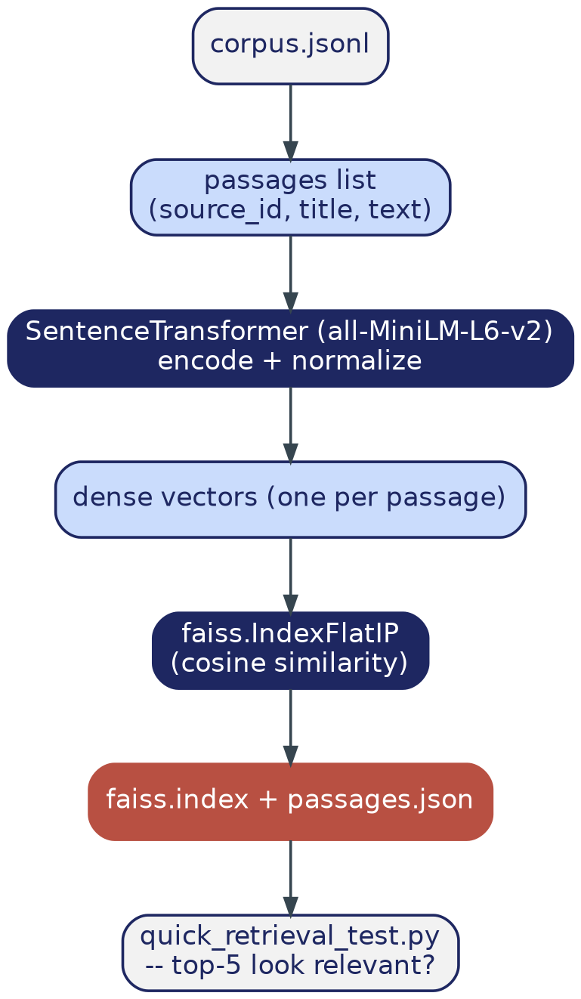

# Phase 4 — RAG: Chunking, Embedding, and Indexing

> **Where this file lives:** `docs/build-guide/04_rag_indexing.md`
> **Diagram referenced below lives at:** `docs/build-guide/diagrams/phase4_flow.png`

---

## 1. Overview — What This Phase Is and Why It Exists

Up to this point, your corpus is just a file of text — finding a relevant passage for a question would mean either exact keyword matching (brittle, misses paraphrases) or a human reading all 400 abstracts by hand. This phase builds the thing that makes "search by meaning" possible: every passage gets converted into a vector of numbers such that passages with *similar meaning* end up with *similar vectors*, and those vectors get stored in a structure (FAISS) built specifically for finding "which stored vectors are closest to this new one" quickly.

This is the foundation Phase 5's entire generation step depends on. If retrieval here is broken or low-quality, no amount of clever prompting in Phase 5 can fix it — the LLM can only generate a good answer from passages it's actually given, and it's only given whatever this phase decides is "relevant."

By the end of this phase you will have:

- `data/faiss.index` — every passage converted to a vector and indexed for fast search
- `data/passages.json` — the original text/metadata, so a search result can be traced back to something readable
- Your own manual confirmation that searching for a real question returns genuinely relevant passages

---

## 2. Phase Data Flow



Every passage goes through the identical transformation (embed → normalize) so that "similarity" becomes one well-defined mathematical operation FAISS can search over. The sanity check at the very bottom of this diagram is not optional decoration — it's the cheapest possible point to catch a broken embedding step, before it silently produces bad retrieval in every single Phase 5 answer.

---

## 3. File Structure — Before and After This Phase

### Before (end of Phase 3):
```
MatSci-RAG/
├── src/
│   └── ... (fetch_corpus.py, prepare_ner_data.py, train_ner.py, run_ner_inference.py)
├── data/
│   ├── corpus.jsonl
│   ├── matscholar_processed/
│   └── structured_facts.jsonl
└── ...
```

### After this phase:
```
MatSci-RAG/
├── src/
│   ├── ... (unchanged)
│   ├── build_index.py              <- NEW
│   └── quick_retrieval_test.py     <- NEW
├── tests/
│   └── test_rag_indexing.py        <- NEW
├── data/
│   ├── corpus.jsonl
│   ├── structured_facts.jsonl
│   ├── faiss.index                 <- NEW (generated, gitignored)
│   └── passages.json               <- NEW (generated, gitignored)
└── ...
```

---

## 4. Git Versioning for This Phase

```bash
git checkout main
git pull
git checkout -b phase-4-rag-indexing
```

**Commit type:** `feat:`
**Tag on completion:** `v0.5.0`

---

## 5. Step-by-Step Implementation

### 5.1 A quick concept check before the code — what "chunking" means here, and a decision I'm making explicit

"Chunking" means splitting documents into passage-sized pieces before embedding them. For long documents, you'd split into overlapping ~200-word windows so no single passage is so long that its embedding becomes a vague average of many different ideas. **For this project, since we're working with abstracts (already short, self-contained, ~150-250 words each), we treat each entire abstract as one passage** — no further splitting needed. This is a deliberate simplification, not a shortcut: it's the correct choice at this scale, and something to explicitly revisit only if you later extend to full paper text (noted as a stretch item in Phase 8).

### 5.2 A quick concept check — why `IndexFlatIP` specifically

FAISS offers several index types. `IndexFlatIP` does an exact (not approximate) search using inner product. Two things make this the right choice here, not just a default:
- **"Flat" = exact search, checks every stored vector.** This is slower than approximate methods (like `IndexIVFFlat`) at huge scale (millions of vectors), but for a few hundred passages, exact search is instant and there's no reason to trade accuracy for speed you don't need yet.
- **Inner product on *normalized* vectors is mathematically identical to cosine similarity** — the standard way to compare embeddings. This is why `normalize_embeddings=True` in the encoding step isn't optional; skip it and the similarity scores stop meaning what you think they mean.

### 5.3 Create `src/build_index.py`

*(Full code — no ambiguity here, both libraries have small, stable, well-documented APIs.)*

```python
# src/build_index.py
"""Embeds every passage in the corpus and builds a FAISS index for fast
similarity search. See Sections 5.1-5.2 above for why we chunk this way and
why this specific index type."""

import json
import faiss
import numpy as np
from sentence_transformers import SentenceTransformer
from logging_config import get_logger

log = get_logger(__name__)

EMBEDDING_MODEL = "sentence-transformers/all-MiniLM-L6-v2"

def build_index(corpus_path: str, index_path: str, passages_path: str) -> int:
    embedder = SentenceTransformer(EMBEDDING_MODEL)

    passages = []
    with open(corpus_path, encoding="utf-8") as f:
        for line in f:
            paper = json.loads(line)
            passages.append({
                "source_id": paper["id"],
                "title": paper["title"],
                "text": paper["abstract"],
            })

    texts = [p["text"] for p in passages]
    embeddings = embedder.encode(texts, show_progress_bar=True, normalize_embeddings=True)

    dim = embeddings.shape[1]
    index = faiss.IndexFlatIP(dim)   # inner product on normalized vectors = cosine similarity
    index.add(np.array(embeddings, dtype="float32"))

    faiss.write_index(index, index_path)
    with open(passages_path, "w", encoding="utf-8") as f:
        json.dump(passages, f)

    log.info(f"Indexed {len(passages)} passages -> {index_path}")
    return len(passages)

if __name__ == "__main__":
    build_index("data/corpus.jsonl", "data/faiss.index", "data/passages.json")
```

### 5.4 Run it

```bash
uv run src/build_index.py
```

### 5.5 Create the manual retrieval sanity check — do not skip this

```python
# src/quick_retrieval_test.py
import faiss, json, numpy as np
from sentence_transformers import SentenceTransformer
from logging_config import get_logger

log = get_logger(__name__)

embedder = SentenceTransformer("sentence-transformers/all-MiniLM-L6-v2")
index = faiss.read_index("data/faiss.index")
passages = json.load(open("data/passages.json"))

def check(query: str, k: int = 5):
    qvec = embedder.encode([query], normalize_embeddings=True)
    scores, indices = index.search(np.array(qvec, dtype="float32"), k)
    for score, idx in zip(scores[0], indices[0]):
        log.info(f"{score:.3f}  {passages[idx]['title']}")

if __name__ == "__main__":
    check("hardness of high entropy alloys")   # change to match your actual topic
```

```bash
uv run src/quick_retrieval_test.py
```

Read the top 5 titles for at least 2-3 different test queries. Do they actually look relevant? This is the single most important verification step in this phase — a broken embedding step won't throw an error, it'll just silently return nonsense that *looks* like it worked because the code ran without crashing.

### 5.6 Write the test

```python
# tests/test_rag_indexing.py
import os

def test_index_and_passages_exist():
    assert os.path.exists("data/faiss.index")
    assert os.path.exists("data/passages.json")
```

```bash
uv run pytest tests/test_rag_indexing.py -v
```

---

## 6. Git: Commit and Merge

```bash
git add src/build_index.py src/quick_retrieval_test.py tests/test_rag_indexing.py
git commit -m "feat: build FAISS index from corpus embeddings, add retrieval sanity check script"

git checkout main
git merge phase-4-rag-indexing
git tag v0.5.0
```

---

## 7. ✅ Phase 4 Checkpoint — Do Not Proceed to Phase 5 Until All Checked

- [ ] `faiss.index` and `passages.json` both exist
- [ ] You ran `quick_retrieval_test.py` with at least 2-3 different queries and the results are genuinely relevant
- [ ] Tests pass
- [ ] Merged to `main`, tagged `v0.5.0`

---

## 8. Troubleshooting

| Symptom | Fix |
|---|---|
| Retrieval returns clearly irrelevant passages | First confirm `normalize_embeddings=True` was used in *both* `build_index.py` and `quick_retrieval_test.py` — a mismatch here silently breaks similarity scoring |
| All similarity scores look nearly identical | Usually means the corpus is too narrow/homogeneous for this query to discriminate well, or the query itself is too generic |
| `faiss.read_index` fails / file not found | Confirm `build_index.py` actually completed (check for the log line "Indexed N passages") before running the retrieval test |
| Very slow encoding | Should be fast (seconds) at ~400 passages on any modern hardware — if it's taking minutes, confirm the embedder is actually loading (check for download progress on first run) |

---

## 9. On Handing This to an IDE Agent

Nothing here needs one for correctness — both `sentence-transformers` and `faiss` have small, stable APIs and the code above is complete. If your project later grows to need proper multi-chunk splitting (per Section 5.1's note, for full-text documents rather than abstracts), that's a reasonable thing to ask an agent to help design — but flag to it explicitly that chunk overlap and boundary handling are the parts worth getting right, not just "split into 200-word pieces."

---

**Next file:** `05_rag_generation.md` — request it once every box in Section 7 is checked.
