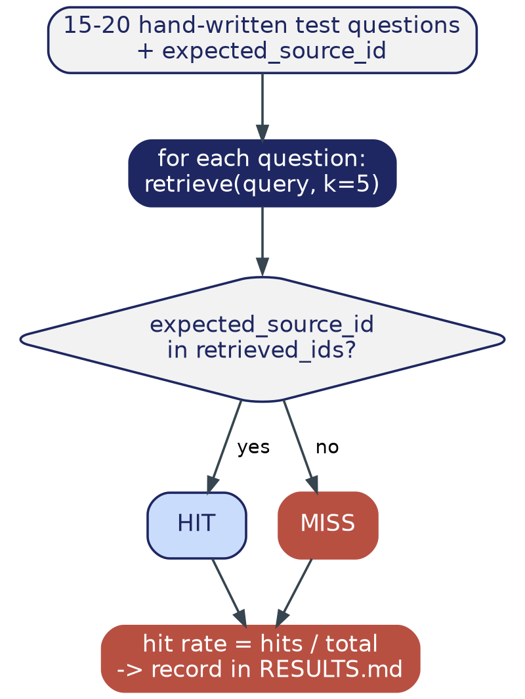

# Phase 6 — Evaluation

> **Where this file lives:** `docs/build-guide/06_evaluation.md`
> **Diagram referenced below lives at:** `docs/build-guide/diagrams/phase6_flow.png`

---

## 1. Overview — What This Phase Is and Why It Exists

Every phase so far has been "build something." This phase is different: it's "measure, honestly, whether what you built actually works." This distinction matters more than it sounds like it should — it's very easy to build a RAG pipeline that *looks* like it's working (it runs, it prints an answer, nothing crashes) while quietly being mediocre at the one thing that matters: retrieving the right information for a real question.

This phase produces the two numbers that will anchor any report, demo, or mentor conversation about this project: the **NER entity-level F1** (already computed in Phase 2, finalized here) and a new metric, the **RAG retrieval hit rate** — the fraction of real test questions where the actually-relevant passage was retrieved in the top-k results.

By the end of this phase you will have:

- A hand-written set of 15-20 real test questions, each tied to a specific, known-correct source abstract
- A measured retrieval hit rate — a single, honest, defensible percentage
- Both this number and Phase 2's F1 comparison recorded together in `RESULTS.md`, forming the evidence base for the whole project

**Important framing before you start:** there is no way to automate the hardest part of this phase. Writing a good test question requires you to have actually read an abstract closely enough to know what a "correct retrieval" for it looks like. This is deliberately the phase with the least code and the most required human judgment in the entire build guide — treat it that way, not as busywork to rush through.

---

## 2. Phase Data Flow



Notice the loop only has two possible outcomes per question — HIT or MISS — and both flow into the same final rate calculation. There's no partial credit here by design: either the source you know is correct showed up in the top-k results, or it didn't. This binary simplicity is a feature, not a limitation — it's what makes the resulting percentage honest and easy to defend, rather than a fuzzy score that's hard to explain to someone else.

---

## 3. File Structure — Before and After This Phase

### Before (end of Phase 5):
```
MatSci-RAG/
├── src/
│   └── ... (fetch_corpus.py, ..., rag_query.py)
├── RESULTS.md            (has the NER F1 table from Phase 2)
└── ...
```

### After this phase:
```
MatSci-RAG/
├── src/
│   ├── ... (unchanged)
│   └── evaluate_rag.py         <- NEW
├── RESULTS.md                   <- UPDATED (RAG hit-rate section added)
└── ...
```

The smallest file-count change of any phase so far — this phase is almost entirely about the *content* of `test_cases`, not new infrastructure.

---

## 4. Git Versioning for This Phase

```bash
git checkout main
git pull
git checkout -b phase-6-evaluation
```

**Commit type:** `test:` — this phase is fundamentally about testing/measurement, a good example of when that commit type is the right one rather than `feat:`.

**Tag on completion:** `v0.7.0`

---

## 5. Step-by-Step Implementation

### 5.1 How to actually write a good test question — worked example

Before writing code, here's the process for **one** test case, so the pattern is clear:

1. Open `data/corpus.jsonl` and pick an abstract you haven't specifically looked at yet.
2. Read it. Find one specific, checkable fact — a material name paired with a property value is ideal (e.g., "this paper reports X alloy has a hardness of Y GPa").
3. Write a question that specifically targets that fact — specific enough that this abstract is clearly *the* right answer, not just *an* answer among several equally-valid ones.
4. Copy that abstract's exact `"id"` field value — this becomes `expected_source_id`.

**A bad test question:** "Tell me about high entropy alloys." (Far too broad — dozens of abstracts could reasonably be "correct.")

**A good test question:** "What hardness has been reported for CrMoNbTiW alloys processed by spark plasma sintering?" (Specific enough that there's a real, checkable right answer.)

Repeat this 15-20 times, spread across different abstracts in your corpus — not all from the same handful of papers.

### 5.2 Create `src/evaluate_rag.py`

*(Full code — the logic is simple and complete; `test_cases` is the part only you can fill in, per Section 5.1.)*

```python
# src/evaluate_rag.py
"""Measures RAG retrieval quality against a hand-written set of test
questions. See Section 5.1 in docs/build-guide/06_evaluation.md for how to
write good test cases -- this is the part that can't be automated."""

import sys
sys.path.append("src")
from rag_query import retrieve
from logging_config import get_logger

log = get_logger(__name__)

# Write 15-20 of these by hand, based on abstracts you've actually read.
# expected_source_id must exactly match an "id" field from data/corpus.jsonl
test_cases = [
    {"query": "What hardness has been reported for CrMoNbTiW alloys?",
     "expected_source_id": "http://arxiv.org/abs/XXXX.XXXXX"},
    # ... add 14-19 more, following the worked example in Section 5.1
]

def run_evaluation(test_cases: list[dict], k: int = 5) -> float:
    hits = 0
    for case in test_cases:
        retrieved = retrieve(case["query"], k=k)
        retrieved_ids = [p["source_id"] for p in retrieved]
        hit = case["expected_source_id"] in retrieved_ids
        hits += hit
        log.info(f"{'HIT ' if hit else 'MISS'}  {case['query']}")
    hit_rate = hits / len(test_cases)
    log.info(f"Retrieval hit rate: {hits}/{len(test_cases)} = {hit_rate:.1%}")
    return hit_rate

if __name__ == "__main__":
    run_evaluation(test_cases)
```

### 5.3 Run it

```bash
uv run src/evaluate_rag.py
```

### 5.4 Look at the misses specifically — this is where the real insight is

A hit rate alone is just a number. Look at *which* questions missed, and ask why:
- Was the query too vague, matching many passages equally well?
- Does the corpus actually contain the answer, but phrased so differently that the embedding model didn't connect it?
- Is this a genuine retrieval failure, or did you make an error in `expected_source_id`?

This qualitative pass is what turns "60% hit rate" from a bare number into an actual finding you can discuss intelligently with a mentor.

### 5.5 (Optional but valuable) Spot-check generated answers, not just retrieval

Retrieval hit rate tells you whether the *right passage* was found. It doesn't tell you whether the *generated answer* actually used it well. For 3-5 of your test questions, run them through `answer_query()` (from Phase 5) instead of just `retrieve()`, and read the full generated answer against its source. This is the same "grounded vs. merely plausible" check from Phase 5, now applied systematically instead of ad hoc.

### 5.6 Record results in `RESULTS.md`

Append to the file from Phase 2:

```markdown
## RAG Retrieval Evaluation (Phase 6)

- Test set size: <N> hand-written questions
- Retrieval hit rate: <X>%
- k (top-k retrieved): 5

### Notes on misses
<briefly describe any patterns you noticed in Section 5.4 -- e.g., vague
queries, paraphrase mismatches, or genuine gaps in the corpus.>

### Answer quality spot-check (Section 5.5)
<a sentence or two on whether generated answers were faithfully grounded
in retrieved passages, for the sample you checked.>
```

---

## 6. Git: Commit and Merge

```bash
git add src/evaluate_rag.py RESULTS.md
git commit -m "test: add RAG retrieval hit-rate evaluation, record results"

git checkout main
git merge phase-6-evaluation
git tag v0.7.0
```

---

## 7. ✅ Phase 6 Checkpoint — Do Not Proceed to Phase 7 Until All Checked

- [ ] `test_cases` has 15-20 real, specific questions written following Section 5.1's pattern — not vague placeholders
- [ ] Every `expected_source_id` was copy-pasted directly from `data/corpus.jsonl`, not typed from memory
- [ ] A documented hit-rate percentage exists in `RESULTS.md` (even 60-70% is a legitimate, honestly-reported first-pass result — don't be tempted to only report your best-case number)
- [ ] You looked at the misses and wrote down *why*, not just the raw percentage
- [ ] Merged to `main`, tagged `v0.7.0`

---

## 8. Troubleshooting

| Symptom | Fix |
|---|---|
| Hit rate suspiciously close to 100% | Double-check your test questions aren't accidentally too easy (e.g., using exact phrases copied straight from the abstract) — that measures memorization of your own wording, not real retrieval quality |
| Hit rate suspiciously low (under 30%) | Check a few `expected_source_id` values are copy-pasted correctly, not mistyped — a typo here silently counts as a miss regardless of whether retrieval was actually fine |
| Every single question misses | Confirm Phase 4's index and Phase 5's `retrieve()` still work at all — re-run `quick_retrieval_test.py` from Phase 4 as a sanity check |

---

## 9. On Handing This to an IDE Agent

The code in Section 5.2 needs no help — it's complete and simple. **What an agent genuinely cannot do for you is Section 5.1** — writing real, specific test questions requires reading your actual corpus, which no model has access to unless you paste content in yourself. If you want help, the right ask is narrow: paste a specific abstract and ask "help me write one precise, checkable question based on this specific text" — not "write me 20 test questions," which would just produce generic, unverifiable placeholders.

---

**Next file:** `07_ui_and_cicd.md` — request it once every box in Section 7 is checked.
