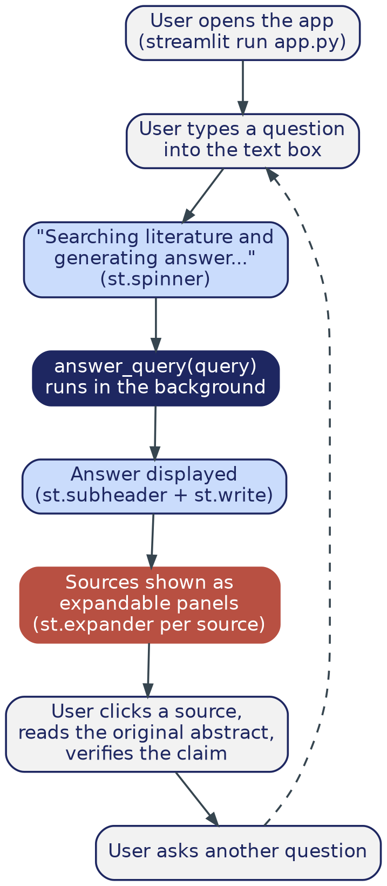

# Phase 7 — Streamlit UI + GitHub Actions CI (uv-based)

> **Where this file lives:** `docs/build-guide/07_ui_and_cicd.md`
> **Diagrams referenced below live at:** `docs/build-guide/diagrams/phase7_user_flow.png` and `docs/build-guide/diagrams/phase7_cicd.png`

---

## 1. Overview — What This Phase Is and Why It Exists

Everything built so far (Phases 1-6) is real and working, but it's only accessible to someone comfortable running Python scripts from a terminal and reading log output. This phase does two, related things: it wraps the working pipeline in an actual interface a non-technical person (your mentor, a classmate) can use directly, and it finishes the CI pipeline that Phase 0 only stubbed out — turning "I tested it on my machine" into "every push is automatically verified, independent of my machine."

Both halves of this phase matter for the same underlying reason: **making the project's correctness and usability independently checkable**, not just something you assert. A demo someone else can click through themselves is more convincing than a description of one. A green CI check that runs on GitHub's servers is more convincing than "it worked when I ran it."

By the end of this phase you will have:

- A working Streamlit chat app (`app.py`) — ask a question, see the answer, see the sources, verify them yourself
- A finished `.github/workflows/ci.yml` that actually lints and tests on every push, using the real, verified `astral-sh/setup-uv` action
- An honest, documented understanding of exactly what your CI does and does not currently verify

---

## 2. What the User Actually Experiences



This diagram is the entire point of Phases 1-6 from someone else's perspective. Everything before this phase was building the engine; this is the dashboard. Pay attention to the "verify" step in particular — it's not a nice-to-have UI detail, it's the direct, visible expression of why this project is a *RAG* system and not just a chatbot: the user isn't asked to trust the answer, they're handed the means to check it themselves.

## What Happens on Every Push


This is what replaces Phase 0's one-line placeholder (`echo "Tests will go here"`). Every step here is real now: install dependencies from the exact locked versions, lint, test — and the result is a single green-or-red signal that means something concrete.

---

## 3. File Structure — Before and After This Phase

### Before (end of Phase 6):
```
MatSci-RAG/
├── src/
│   └── ... (fetch_corpus.py, ..., evaluate_rag.py)
├── .github/workflows/
│   └── ci.yml                  (Phase 0's placeholder — just an echo statement)
├── RESULTS.md
└── ...
```

### After this phase:
```
MatSci-RAG/
├── src/
│   └── ... (unchanged)
├── app.py                       <- NEW
├── tests/
│   ├── ... (existing phase test files)
│   └── test_pipeline.py         <- NEW
├── .github/workflows/
│   └── ci.yml                   <- REPLACED (real lint + test workflow, not a placeholder)
└── ...
```

---

## 4. Git Versioning for This Phase

```bash
git checkout main
git pull
git checkout -b phase-7-ui-cicd
```

**Commit type:** `feat:`
**Tag on completion:** `v0.8.0`

---

## 5. Step-by-Step Implementation

### 5.1 Create `app.py`

*(Full code — Streamlit's API for this use case is small and stable.)*

```python
# app.py
"""The user-facing chat interface. This is the diagram from Section 2 above,
made real: a question in, a grounded answer + verifiable sources out."""

import streamlit as st
import sys
sys.path.append("src")
from rag_query import answer_query

st.title("Materials Science Literature Assistant")
st.write("Ask a question about the papers in this assistant's knowledge base.")

query = st.text_input("Your question:")

if query:
    with st.spinner("Searching literature and generating answer..."):
        answer, retrieved = answer_query(query)

    st.subheader("Answer")
    st.write(answer)

    st.subheader("Sources used")
    for i, p in enumerate(retrieved):
        with st.expander(f"[{i+1}] {p['title']}"):
            st.write(p["text"])
            st.caption(f"Source: {p['source_id']}")
```

### 5.2 Run it and actually use it

```bash
uv run streamlit run app.py
```

Open the local URL it prints. Walk through the exact user-flow diagram from Section 2 yourself: type a question, read the answer, expand a source, confirm it actually supports the claim. Try this with at least 2-3 of the same test questions from Phase 6 — seeing the same evaluation you already did, now through the actual interface, is a good final confirmation everything is wired together correctly end to end.

### 5.3 Create `tests/test_pipeline.py`

*(Full code — a lightweight end-to-end smoke test, deliberately narrow in scope; see Section 6 for why.)*

```python
# tests/test_pipeline.py
import sys
sys.path.append("src")

def test_retrieval_returns_results():
    from rag_query import retrieve
    results = retrieve("hardness of high entropy alloys", k=3)
    assert len(results) == 3
    assert all("text" in r for r in results)
```

### 5.4 Replace Phase 0's placeholder with the real `.github/workflows/ci.yml`

*(Full code — this uses the verified, current official pattern for `uv` in GitHub Actions, confirmed directly against Astral's own documentation, not assumed from memory.)*

```yaml
name: CI

on:
  push:
    branches: [main]
  pull_request:
    branches: [main]

jobs:
  lint-and-test:
    runs-on: ubuntu-latest
    steps:
      - name: Checkout repository
        uses: actions/checkout@v7

      - name: Install uv
        uses: astral-sh/setup-uv@v7
        with:
          enable-cache: true

      - name: Install the project
        run: uv sync --locked --all-extras --dev

      - name: Lint with ruff
        run: uv run ruff check .

      - name: Run tests
        run: uv run pytest tests/ -v
```

**Why each piece is there, not just what it does:**
- `uv sync --locked` installs the *exact* versions frozen in `uv.lock` — CI is guaranteed to test precisely what you tested locally, never "whatever's newest today," which is exactly the reproducibility guarantee Phase 0 was built around.
- `enable-cache: true` caches uv's downloads between CI runs, so GitHub doesn't re-download PyTorch from scratch on every single push.
- Pinning to a full commit hash instead of `@v7` is the stricter, more security-conscious production practice (protects against a compromised tag being silently repointed — a real, documented supply-chain attack pattern). `@v7` is a reasonable, more-readable tradeoff for a student project; noting the stricter option here is itself good practice, so the tradeoff is a documented decision, not an oversight.

### 5.5 Why the NER model test isn't in CI — a documented limitation, not a gap you should hide

`models/matscibert_ner/` is a local training output from Phase 2 — it's gitignored (too large for git) and simply won't exist on a fresh GitHub Actions runner. Three honest options, increasing in effort:

1. **Skip it in CI for now** (what we're doing here) — the model-dependent tests from Phases 2-3 run locally only.
2. **Push the model to the Hugging Face Hub** as a model repo, and have CI download it — the more complete production answer, worth doing once your NER results are finalized and stable.
3. **Use Git LFS** to version the checkpoint directly — usually not worth the complexity for a project at this scale.

Add a short, explicit note about this to your project's main `README.md` under a "CI Limitations" heading. Being upfront about a known gap is a real production practice — a green CI badge that quietly means less than it appears to is worse than an honest note explaining the actual scope of what's verified.

---

## 6. Git: Commit and Merge

```bash
git add app.py tests/test_pipeline.py .github/workflows/ci.yml
git commit -m "feat: add Streamlit chat UI and GitHub Actions CI workflow using uv"

git checkout main
git merge phase-7-ui-cicd
git tag v0.8.0
```

Push to GitHub and confirm the Actions tab shows an actual green run — not just that the file exists, but that it executed successfully against your real repository.

```bash
git push origin main --tags
```

---

## 7. ✅ Phase 7 Checkpoint — Do Not Proceed to Phase 8 Until All Checked

- [ ] `uv run streamlit run app.py` works end to end in the browser
- [ ] You personally walked through the user-flow diagram (Section 2) with 2-3 real questions
- [ ] `uv run pytest tests/` passes locally
- [ ] Pushing to GitHub triggers the Actions workflow, and it passes (check the Actions tab, don't just assume)
- [ ] The "CI Limitations" note exists in your main `README.md`
- [ ] Merged to `main`, tagged `v0.8.0`

---

## 8. Troubleshooting

| Symptom | Fix |
|---|---|
| Streamlit app can't import `rag_query` | Confirm you're running `uv run streamlit run app.py` from the project root, not from inside `src/` |
| CI fails on `uv sync` | Confirm `uv.lock` was actually committed — CI can't reproduce an environment from a lockfile that isn't in the repo |
| CI passes locally but fails on GitHub | Almost always an environment difference — check the Actions log output directly rather than guessing; it's usually explicit about what failed |
| Streamlit app is slow to first respond | Normal — the embedding + generation models load into memory on first request; subsequent questions in the same session should be faster |

---

## 9. On Handing This to an IDE Agent

Both `app.py` and `ci.yml` above are complete, verified, and shouldn't need agent help for correctness. Where an agent genuinely helps in this phase: **visual polish on the Streamlit app** (styling, layout, adding a sidebar with corpus stats, etc.) is low-risk, presentation-only territory — a reasonable and safe thing to hand off, since it can't silently break the underlying RAG logic this phase depends on.

---

**Next file:** `08_stretch_improvements.md` — request it once every box in Section 7 is checked.
