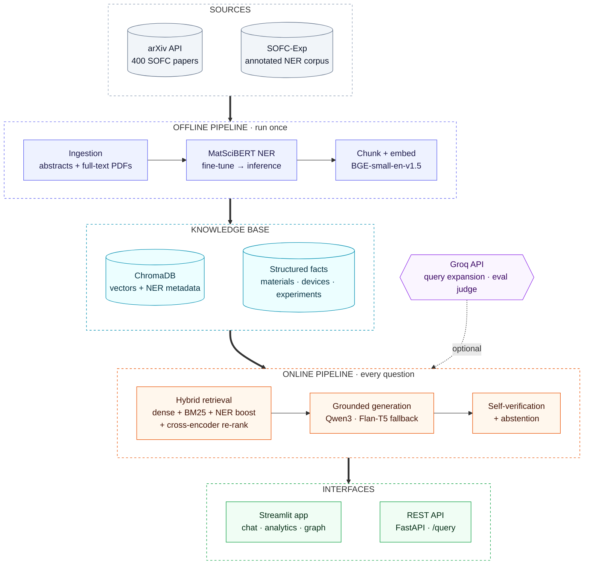
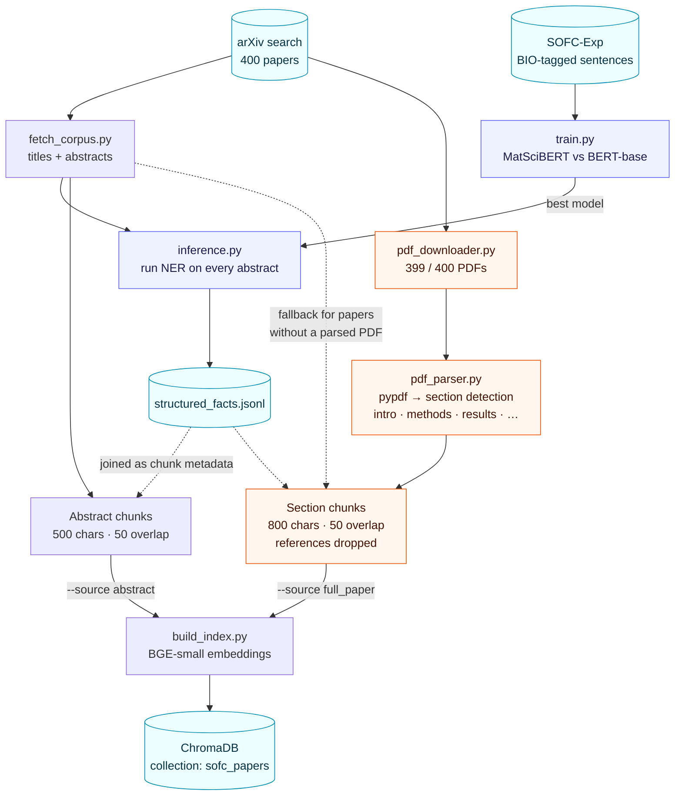
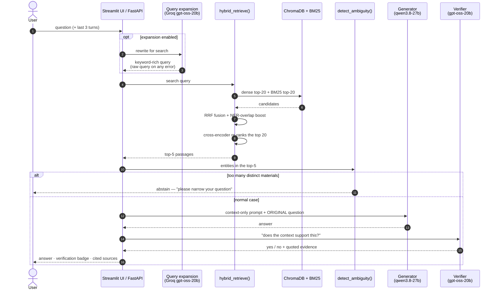
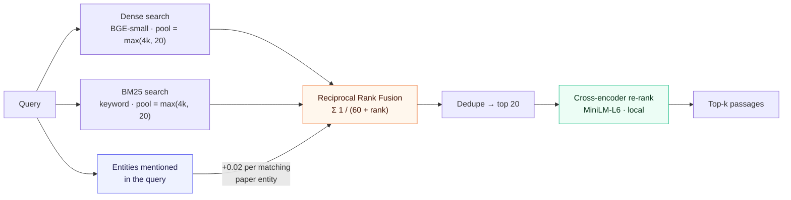
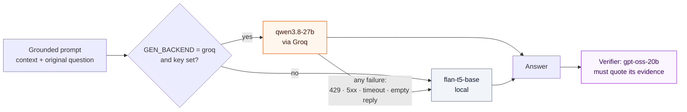
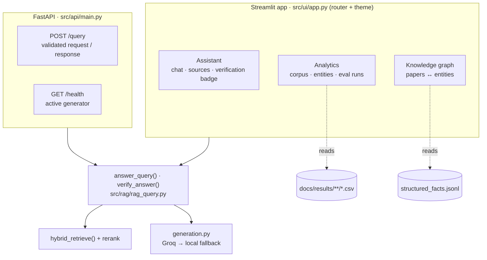
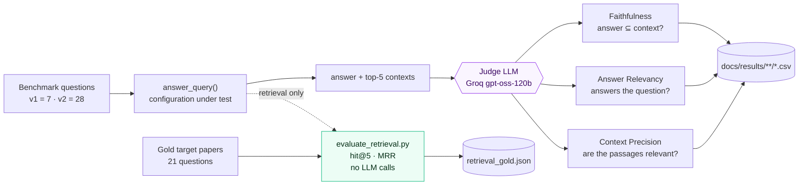
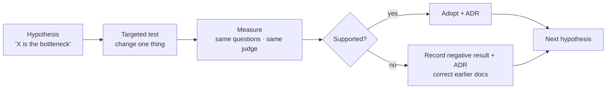

# MatSci-RAG — The Complete Guide

*One document that explains the whole project: what it is, why it was built this way, how every part
works, what was measured, what went wrong, and what is still open. All architecture diagrams are
here. For slides, use [`PPT-Source.md`](PPT-Source.md), which is built from this file.*

**State of the project: 2026-10-11.** 19 ADRs, 60 tests, 11 phases (0–10). Numbers in this file are
copied from the evaluation CSVs in `docs/results/`; where something has **not** been measured, the text says so.

---

## Contents

1. [The project in one page](#1-the-project-in-one-page)
2. [Background you need](#2-background-you-need)
3. [Data and models](#3-data-and-models)
4. [Architecture (all diagrams)](#4-architecture-all-diagrams)
5. [How each component works](#5-how-each-component-works)
6. [How the project was built: phases 0–10](#6-how-the-project-was-built-phases-010)
7. [Results](#7-results)
8. [The investigation story: hypotheses tested](#8-the-investigation-story-hypotheses-tested)
9. [Decision records (ADR-001 to ADR-019)](#9-decision-records)
10. [Bugs found and what they teach](#10-bugs-found-and-what-they-teach)
11. [Limitations, stated plainly](#11-limitations-stated-plainly)
12. [What is pending](#12-what-is-pending)
13. [How to run and reproduce](#13-how-to-run-and-reproduce)
14. [Likely questions and short answers](#14-likely-questions-and-short-answers)
15. [Numbers cheat sheet](#15-numbers-cheat-sheet)

---

## 1. The project in one page

**MatSci-RAG answers questions about Solid Oxide Fuel Cell (SOFC) materials, using only 400 arXiv
papers as its source, and shows where each answer came from.**

**The problem.** A general-purpose chatbot invents plausible-sounding technical facts
(hallucination). A generic RAG system (retrieve text, then answer from it) fixes much of that but
handles this field badly: searching for *"cathode materials"* returns lithium-battery papers, and
chemical formulas like `La0.6Sr0.4Co0.2Fe0.8O3` do not embed meaningfully.

**The idea.** Add a materials-science layer on top of RAG:

1. A **MatSciBERT** model, fine-tuned for materials named-entity recognition (NER), tags the
   materials, devices and experiments in every paper.
2. **Hybrid retrieval** (meaning-based + keyword search) uses those tags as a *soft boost*, so
   fuel-cell papers rank higher without ever filtering any paper out.
3. A **cross-encoder** re-reads the top candidates and re-orders them by how well they answer the question.
4. A strong LLM writes the answer **only** from the retrieved passages; a *different* LLM checks it
   and quotes its evidence; the system says "I don't know" when the literature is silent.

**What it ships as.** A Streamlit app (chat, analytics, knowledge graph), a FastAPI REST API, an
evaluation harness, 19 decision records, 60 tests and CI.

**The most important thing about it.** It is a *measured* project. Almost every design choice was
tested against a number, several early beliefs were disproved by those numbers, and the
documentation corrects them openly. The story in [Section 8](#8-the-investigation-story-hypotheses-tested)
is as important as the system.

**Base work.** Extends Maharana et al. (2025), a RAG + NER pipeline for materials literature (their
domain: solid-state hydrogen storage). Verification borrows from Polak & Morgan's *ChatExtract*.
NER training data: SOFC-Exp (Brack et al., 2020).

---

## 2. Background you need

| Term | Meaning in this project |
|---|---|
| **Hallucination** | An LLM stating fluent but unsupported facts. RAG exists to reduce it. |
| **RAG** | Retrieval-Augmented Generation: fetch relevant text first, then make the model answer *from that text*. |
| **Embedding / dense retrieval** | Text turned into a vector so similar *meanings* are close. Good at paraphrase, weak at exact formulas and acronyms. Here: `BAAI/bge-small-en-v1.5`. |
| **BM25** | Classic keyword scoring. Strong on exact terms (`YSZ`, `LSCF`), blind to meaning. |
| **RRF** (Reciprocal Rank Fusion) | Merges two ranked lists by summing `1/(60 + rank)` per list. Needs no score calibration. |
| **Chunking** | Splitting papers into passages (500 chars for abstracts, 800 for full text, 50 overlap). |
| **Vector DB** | Stores chunk vectors + metadata for fast similarity search. Here: ChromaDB. |
| **NER** | Tagging spans of text as entity types: `MATERIAL`, `DEVICE`, `EXPERIMENT`, `VALUE`, using BIO tags (`B-` begin, `I-` inside, `O` outside). |
| **Fine-tuning / domain pretraining** | Continuing to train a pretrained model on a task. **MatSciBERT** was pretrained on 2.4M materials papers, so it already knows the vocabulary. |
| **Precision / recall / F1** | Of what the model tagged, how much was right; of what was there, how much it found; their harmonic mean. |
| **Cross-encoder** | A model that reads the query and one passage *together* and scores relevance. Far more accurate than comparing two separate vectors, but too slow for the whole corpus, so it only re-scores ~20 candidates. |
| **Self-verification** | A second model call asking "does the context support this answer?" and quoting evidence. |
| **Abstention** | Refusing to answer: the context is silent, or the question is too ambiguous. |
| **Query expansion** | An LLM rewrites the question into a keyword-rich search query. Affects *retrieval only*; the generator still sees the original question. |
| **LLM-as-judge** | A model scores answers on a rubric. Used for the evaluation. Here: Faithfulness, Answer Relevancy, Context Precision. |
| **Faithfulness** | Does the answer use only facts present in the retrieved context? |
| **Answer Relevancy** | Does the answer actually address the question? (A model can be faithful and still useless, e.g. "I don't know".) |
| **Context Precision** | What fraction of the retrieved passages are relevant to the question? Depends only on retrieval. |
| **hit@k / MRR** | Retrieval metrics: is a correct paper in the top k; mean of 1/(rank of the first correct paper). |
| **ADR** | Architecture Decision Record: a short document capturing a decision, its context and its consequences. |

---

## 3. Data and models

### Data

| Dataset | What | Size | Role |
|---|---|---|---|
| arXiv SOFC corpus | Titles + abstracts from an arXiv keyword search | 400 papers | The knowledge base |
| Full-text PDFs | Downloaded and parsed into sections | 399 / 400 papers (1 PDF returns 404; that paper keeps its abstract) | Richer index |
| SOFC-Exp | Human-annotated NER sentences (CC-BY-4.0) | 876 sentences | NER training |
| `structured_facts.jsonl` | NER output per paper: materials, devices, experiments | 400 records | Retrieval boost, knowledge graph |
| ChromaDB index | Chunk vectors + metadata | **22,659** (full text, live) or 1,330 (abstracts) | Retrieval |

### Models (all configurable in `src/core/config.py`)

| Role | Model | Runs where | Why |
|---|---|---|---|
| NER | `m3rg-iitd/matscibert` (vs `bert-base-uncased` baseline) | local | Domain-pretrained |
| Embeddings | `BAAI/bge-small-en-v1.5` | local | Strong small retrieval model |
| Re-ranker | `cross-encoder/ms-marco-MiniLM-L-6-v2` | local | 22M params, +~100 ms/query |
| Answer generator | `qwen/qwen3.8-27b` | Groq API | Far larger than local hardware allows |
| Generator fallback | `google/flan-t5-base` | local | Used automatically if Groq fails |
| Self-verifier | `openai/gpt-oss-20b` | Groq API | Deliberately a *different* model |
| Query expansion | `openai/gpt-oss-20b` | Groq API | Fast rewrite |
| Evaluation judge | `openai/gpt-oss-120b` | Groq API | Third distinct model: none grades itself |

---

## 4. Architecture (all diagrams)

### 4.1 System overview

Two halves run at different times: an **offline pipeline** builds the knowledge base once; an
**online pipeline** answers every question. They share the same NER facts.



### 4.2 Offline: building the knowledge base



The index is built from **either** abstracts **or** full-text sections; rebuilding always replaces
the collection and never merges the two. `build_index --fuel-cell-only` indexes just the 145 papers
that mention a fuel-cell technology (an option, not the default; see ADR-017).

### 4.3 Online: answering one question



Expansion changes only **what is searched for**. The generator always sees the original question,
so a bad rewrite cannot put words in the answer.

### 4.4 Retrieval, zoomed in



**Why the NER is a boost, not a filter (ADR-009).** An early version hard-filtered results by NER
tags. The data showed why that fails: **68% of papers have no extracted `devices` at all**, so a
filter silently discarded most of the corpus. Entities now only *lift* relevant papers; they can
never remove one.

### 4.5 Generation with fallback



`GEN_BACKEND=local` forces fully offline operation. A warning is logged whenever the fallback triggers.

### 4.6 Interfaces and components



### 4.7 Evaluation harness



Transient API errors are retried with backoff. Any other judge failure **aborts the run**; it is
never recorded as a score. Runs save each question as they go and continue with `--resume`.

### 4.8 The investigation loop (how decisions were made)



### 4.9 Project layout

```
MatSci-RAG/
├── src/
│   ├── core/        config.py (all settings) · logging_config.py
│   ├── ingestion/   fetch_corpus.py · pdf_downloader.py · pdf_parser.py
│   ├── ner/         prepare_data.py · train.py · inference.py
│   ├── rag/         build_index.py · hybrid_retrieval.py · rerank.py · corpus_filter.py
│   │                ner_utils.py · query_expansion.py · generation.py · rag_query.py
│   ├── api/main.py  FastAPI
│   └── ui/          app.py · theme.py · views/{chat, analytics, knowledge_graph}.py
├── scripts/         evaluate_ragas.py · evaluate_retrieval.py · benchmark_questions.py
│                    retrieval_gold.py · ingest_full_papers.py · evaluate_rag.py
├── tests/           60 tests (51 run everywhere incl. CI; 9 need local data and skip cleanly)
├── docs/            ADRs/ (19) · Phases/ · results/ · assets/ · Complete-Guide.md · PPT-Source.md
└── data/ models/    gitignored, generated by the offline pipeline
```

---

## 5. How each component works

### 5.1 NER (Phases 2–3)
Token classification with BIO tags over four entity types. MatSciBERT and `bert-base-uncased` were
fine-tuned with *identical* hyperparameters on the same SOFC-Exp split, so any difference comes only
from pretraining. Inference runs NER over every abstract and writes `structured_facts.jsonl`
(materials, devices, experiments per paper). Raw output is noisy; `clean_entities()` removes junk
tokens before use.

### 5.2 Indexing (Phase 4, extended in 9–10)
Each paper is chunked (500 chars for abstracts, 800 for full-text sections, 50 overlap), each chunk
is embedded with BGE-small, and the NER facts of its paper are attached as metadata. Full-text mode
drops reference sections and falls back to the abstract for any paper without a parsed PDF, so no
paper silently disappears.

### 5.3 Hybrid retrieval (Phase 8)
Dense top-N and BM25 top-N (N = max(4k, 20)) are fused by RRF. Papers whose NER entities appear in
the query get a small additive boost (+0.02 per matching entity). This is a *soft* signal because
NER coverage is incomplete.

### 5.4 Cross-encoder re-ranking (Phase 10, ADR-019)
The fused top 20 are re-scored by a local cross-encoder that reads query and passage together; the
best 5 go forward. An optional per-paper cap (`per_paper_cap`) limits how many of the final chunks
may come from one paper; it is implemented and measured but off by default. `USE_RERANK=0` disables
re-ranking.

### 5.5 Grounded generation (Phase 5, rebuilt in 10)
A strict prompt tells the model to answer **only** from the numbered context and to say it doesn't
know otherwise. Since ADR-016 the generator is `qwen3.8-27b` on Groq with an automatic local
Flan-T5 fallback. Reasoning-model quirks are handled: `gpt-oss` needs `reasoning_effort="low"` and
extra `max_tokens` headroom, because its hidden reasoning tokens count toward the limit.

### 5.6 Self-verification (Phase 8, strengthened in 10)
A second, *different* model is asked whether the context supports the answer and must quote the
supporting sentence. The UI shows a badge plus the quote. It checks consistency with the retrieved
evidence, not absolute truth; if retrieval returned the wrong passage, a faithful answer can still
be wrong.

### 5.7 Ambiguity abstention (Phase 8)
If the top passages span many distinct materials, the system asks the user to narrow the question.
Because NER extraction is noisy, the threshold is set high so it fails safe: it rarely fires. This
is a known, documented limitation, not a bug.

### 5.8 Multi-turn memory and query expansion (Phase 9)
The last 3 turns are passed to query expansion and the prompt, so follow-ups resolve pronouns.
Expansion is an LLM rewrite used for retrieval only; on any error it silently returns the raw query
(designed to degrade gracefully, but see [Section 10](#10-bugs-found-and-what-they-teach) for the trap).

### 5.9 Full-paper ingestion (Phase 9–10)
`pdf_downloader.py` fetches PDFs (idempotent), `pdf_parser.py` uses `pypdf` and a regex to split
sections, `ingest_full_papers.py` orchestrates it. Result: 22,659 chunks from 399 papers.

### 5.10 Knowledge graph and analytics (Phase 9)
Standalone Streamlit pages. The graph (pyvis/networkx, shown via `st.iframe`) links papers to the
materials, devices and experiments extracted from them. Analytics reads corpus stats, entity counts
and every evaluation CSV. Neither is in the query path.

### 5.11 REST API (Phase 10, ADR-014)
`POST /query` takes `question` (1–1000 chars), `use_hybrid`, `expand_query`, `verify` and
`chat_history` (max 20 turns); returns `answer`, `abstained`, `verification` and `sources` (rank,
title, paper_id, section, text). The pipeline is imported lazily and guarded by a lock. Docker was
built, then deliberately dropped for its disk cost (recorded in ADR-014).

### 5.12 Evaluation (Phases 6, 9, 10)
Three layers: a 20-question dense-retrieval hit-rate test (Phase 6); the LLM-judge harness with
Faithfulness / Answer Relevancy / Context Precision; and the judge-free retrieval check
(`evaluate_retrieval.py`) that asks whether a gold paper is in the top 5.

---

## 6. How the project was built: phases 0–10

| Phase | What was built | Key outcome |
|---|---|---|
| 0 | Environment: `uv`, `ruff`, pre-commit, logging, CI scaffold | Reproducible setup |
| 1 | Corpus: 400 SOFC abstracts from arXiv | The knowledge base |
| 2 | NER training: MatSciBERT vs BERT-base | F1 0.0915 vs 0.0816 (domain pretraining helps) |
| 3 | NER inference over the corpus | `structured_facts.jsonl` |
| 4 | Chunking, embeddings, ChromaDB with NER metadata | 1,330-chunk index |
| 5 | Retrieval + strictly grounded generation | First end-to-end answers |
| 6 | Hand-written test questions, retrieval hit-rate | 20/20 in top 5 (dense) |
| 7 | Streamlit UI + GitHub Actions CI | Usable app, automated checks |
| 8 | Self-verification, ambiguity abstention, hybrid NER-boosted retrieval | Reliability layer; fixed a battery-vs-SOFC retrieval failure |
| 9 | Six extensions: multi-turn memory, LLM-judge eval, query expansion, full-paper ingestion, knowledge graph, analytics | 3 change the query path; 3 are tools around it |
| 10 | Full-scale measurement, REST API, redesigned UI, Groq generator, corpus filter test, 28-question benchmark, cross-encoder | See Sections 7–8 |

Phase 10 in detail:

| Step | Why |
|---|---|
| Full text for 399/400 papers (was 55) | Phase 9's full-paper result was on a 55-paper subset |
| Re-measured all configurations under a new judge | Groq retired the old one; old and new scores aren't comparable |
| Tested `flan-t5-large` (ADR-015) | Was model *size* the generation bottleneck? (No.) |
| REST API (ADR-014) | A validated programmatic interface |
| Redesigned UI (router, shared theme, three views) | Sources and verification persist in chat history |
| Groq generator + fallback + separate verifier (ADR-016) | The measured generation bottleneck |
| Fuel-cell corpus filter (ADR-017) | Test whether off-topic papers hurt (they don't, measurably) |
| 28-question benchmark + diagnosis (ADR-018) | 7 questions couldn't resolve small effects; exposed a wrong explanation |
| Cross-encoder re-ranking (ADR-019) | Fix the retrieval-ranking bottleneck ADR-018 found |

---

## 7. Results

### 7.1 NER — domain pretraining helps

| Model | Test F1 |
|---|---:|
| BERT-base | 0.0816 |
| **MatSciBERT** | **0.0915** |

Absolute F1 is low: small training set (876 sentences), most tokens are non-entities. The *comparison*
is the point: same data, same hyperparameters, only the pretraining differs.

### 7.2 Retrieval

| Test | Result |
|---|---|
| Dense retrieval hit-rate, 20 specific questions | 100% (20/20) correct paper in top 5 |
| "Which cathode materials show high ORR activity?" | Dense-only returns a battery paper (answers FePO₄); hybrid returns the SOFC paper (answers perovskite) |

100% needs context: these are 20 hand-written, fact-specific questions, each with a single
unambiguous source paper, measured on dense retrieval only (`scripts/evaluate_rag.py`, k = 5). It
shows retrieval works on *specific* queries; it is not a claim about vague or ambiguous ones, and
it is not a hybrid-retrieval benchmark.

### 7.3 End-to-end quality — 7 questions, 10 configurations (LLM judge: `gpt-oss-120b`)

| Index | Generator | Expansion | Faithfulness | Answer Relevancy | Context Precision |
|---|---|:---:|---:|---:|---:|
| Abstracts | flan-t5-base | | 0.857 | 0.000 | 0.314 |
| Abstracts | flan-t5-base | on | 0.857 | 0.143 | 0.486 |
| Abstracts | flan-t5-large | | 0.857 | 0.000 | 0.343 |
| Abstracts | flan-t5-large | on | 0.857 | 0.071 | 0.457 |
| Full text | flan-t5-base | | 0.857 | 0.071 | 0.586 |
| Full text | flan-t5-base | on | 0.857 | 0.000 | 0.571 |
| Full text | flan-t5-large | | 0.714 | 0.000 | 0.586 |
| Full text | flan-t5-large | on | 0.857 | 0.000 | 0.543 |
| Full text | qwen3.8-27b | | **1.000** | 0.429 | 0.543 |
| **Full text** | **qwen3.8-27b** | **on** | 0.857 | **0.714** | 0.543 |

Last row is the default configuration. The judge itself varies about ±0.03 between identical
retrievals, and 7 questions only detect large effects.

### 7.4 Corpus filter (ADR-017) — 7 questions, qwen3.8-27b

| Index | Expansion | Faithfulness | Answer Relevancy | Context Precision |
|---|:---:|---:|---:|---:|
| Full text, 400 papers | | 1.000 | 0.429 | 0.543 |
| Full text, 400 papers | on | 0.857 | 0.714 | 0.543 |
| Fuel-cell only, 145 papers | | 0.857 | 0.429 | 0.600 |
| Fuel-cell only, 145 papers | on | 0.786 | 0.571 | 0.514 |

No measurable gain from removing the off-topic papers.

### 7.5 The 28-question benchmark (ADR-018) — full text, qwen3.8-27b, no expansion

| Set | Faithfulness | Answer Relevancy | Context Precision | "I don't know" |
|---|---:|---:|---:|---:|
| All 28 | 0.982 | 0.607 | 0.582 | 11 / 28 |
| Original 7 | | 0.429 | | 3 / 7 |
| New 21 | | 0.667 | | 8 / 21 |

Not comparable with the 7-question tables (different question mix, and the new questions were
written from corpus topics).

### 7.6 Retrieval with and without re-ranking (ADR-019) — 21 gold-labelled questions, judge-free

| Configuration | hit@5 | MRR | Distinct papers in top 5 |
|---|---:|---:|---:|
| Baseline (RRF + NER boost) | 0.714 | 0.448 | 2.71 |
| Cap 2 chunks per paper | 0.762 | 0.463 | 3.43 |
| **Cross-encoder** (default) | **0.952** | **0.849** | 2.86 |
| Cross-encoder + cap 2 | 0.952 | 0.849 | 3.52 |

Cost about +100 ms per query (218 → 317 ms). The gold target papers were chosen by the system's
author from corpus titles, so this is a judgement, not ground truth.

### 7.7 Engineering quality

60 automated tests (51 run on any machine including CI, 9 need local data and skip cleanly), `ruff`
lint and format clean, GitHub Actions CI on every push, pre-commit hooks.

---

## 8. The investigation story: hypotheses tested

This is the heart of the project. Each row is a belief that was tested; several were wrong.

| # | Belief | Test | Result | Decision |
|---|---|---|---|---|
| 1 | Generic RAG is enough for this domain | Dense-only vs hybrid on a cathode query | Dense returned a battery paper and answered FePO₄ | Add BM25 + NER boost (ADR-005, 009) |
| 2 | NER tags can *filter* results | Inspect NER coverage | 68% of papers have no `devices`; a filter would drop most of the corpus | Use NER as a soft boost (ADR-009) |
| 3 | Abstracts lack the detail needed | Index full text | Context Precision 0.314 → 0.586 | Serve full text by default (ADR-012, 015) |
| 4 | Query expansion + full text will compound | Run both | Answer Relevancy collapsed to 0.000 (with Flan-T5) | Negative result documented; later explained by the weak generator |
| 5 | A bigger Flan-T5 will fix generation | `flan-t5-large` | Became *more cautious* ("I don't know" on 6 of 7), not better | Not adopted (ADR-015) |
| 6 | Generation is the bottleneck | Swap in `qwen3.8-27b`, nothing else changed | Answer Relevancy 0.071 → 0.429 (0.714 with expansion) | Adopt Groq generator + fallback (ADR-016) |
| 7 | Same-model self-check is a safeguard | Live test | The Flan-T5 verifier approved an answer taken from the wrong passage | Use a separate verifier that quotes evidence (ADR-016) |
| 8 | Off-topic papers are hurting retrieval | Index only the 145 fuel-cell papers | No measurable gain | Keep as option (ADR-017) |
| 9 | Remaining "I don't know"s mean the corpus lacks the papers | Larger benchmark; check whether the answering paper exists | **Wrong.** In 4 of 5 checked cases the paper exists but ranks outside the top 5 | Correct ADR-016/017; fix ranking (ADR-018) |
| 10 | A cross-encoder will fix ranking | Judge-free retrieval check, 21 questions | hit@5 0.714 → 0.952, MRR 0.448 → 0.849 | Adopt, on by default (ADR-019) |

**The pattern.** Fix what the numbers show, not what feels likely. Belief 9 is the clearest
example: an explanation inferred without checking was wrong, and the docs were corrected rather than
left to stand.

---

## 9. Decision records

| ADR | Decision | Status |
|---|---|---|
| 001 | Use SOFC-Exp for NER training | Accepted |
| 002 | MatSciBERT over BERT-base as the NER backbone | Accepted (F1 numbers superseded by 004) |
| 003 | Fetch a SOFC-specific arXiv corpus for inference | Accepted |
| 004 | Fix a Windows `\r\n` character-offset bug in the NER parser | Accepted |
| 005 | ChromaDB + BGE over FAISS + MiniLM | Accepted |
| 006 | Raw `model.generate()` over a LangChain pipeline | Accepted |
| 007 | Streamlit UI; `fileWatcherType=none` for Windows | Accepted |
| 008 | Phase 8 bug fixes: import order, double import | Accepted (NER filter part superseded by 009) |
| 009 | NER-aware *re-ranking* instead of a metadata filter | Accepted |
| 010 | Multi-turn memory + LLM-judge evaluation (judge model since replaced) | Accepted |
| 011 | LLM-based query expansion | Accepted |
| 012 | Full-paper ingestion via PDF download + section parsing | Accepted |
| 013 | Knowledge graph visualization | Accepted |
| 014 | REST API (Docker built, then dropped for disk cost) | Accepted |
| 015 | flan-t5-large evaluated, not adopted; full-corpus measurements | Accepted (generator choice superseded by 016) |
| 016 | Groq generator with local fallback; separate verifier | Accepted |
| 017 | Fuel-cell corpus filter: built, measured, not the default | Accepted (optional) |
| 018 | 28-question benchmark; corrects the "coverage" explanation | Accepted |
| 019 | Cross-encoder re-ranking after hybrid retrieval | Accepted (judged end-to-end run pending) |

Files: `docs/ADRs/ADR-0NN-*.md`. Each states Context, Decision, Reasoning/Measurement and Consequences.
When a decision is reversed the old ADR is marked superseded and keeps its measurements; nothing is deleted.

---

## 10. Bugs found and what they teach

The recurring theme is **silent failure**: things that looked healthy from outside.

| Bug | How it hid | Fix |
|---|---|---|
| PDF downloads failed for **100%** of papers | A wrong `arxiv` API call; failures were swallowed | Corrected the call; idempotent downloader |
| The retired judge model's 404s were scored as **0.0** | Averages looked like bad quality, not a broken judge | Evaluator retries transient errors and **aborts** on anything else; it never invents a score |
| Query expansion silently did nothing | The expansion model was retired; code fell back to the raw query by design | `--expand` now preflights the model and fails fast |
| Chat UI could not import its own package | A restructure moved `src`; Streamlit's path didn't include the root | Router inserts the project root on `sys.path` |
| Knowledge graph crashed the page | `st.iframe` scrolling option unsupported | Removed the option |
| Graph node colours ignored | The vis.js `group` attribute overrode colours | Renamed the attribute to `kind` |
| Windows `\r\n` offset bug in NER parsing | Character offsets shifted, corrupting labels | Fixed in the parser (ADR-004) |
| Evaluator crashed on a symbol Windows' console can't print | A model answer contained a non-ASCII character | Output now replaces unprintable characters |
| A daily Groq judge cap killed two long runs | 200,000 tokens/day; one 28-question run uses ~190,000 | Evaluator saves per question; `--resume` |
| An explanation ("no paper has the answer") was never checked | Plausible from reading outputs | Checked in ADR-018; wrong; docs corrected |

---

## 11. Limitations, stated plainly

1. **NER quality is low (F1 ≈ 0.09).** Few papers have a clean extracted material or device. This
   caps how much the NER-driven features can add and is why the NER is a soft boost.
2. **Ambiguity abstention rarely fires**, as a direct consequence of (1). Its threshold is set to
   fail safe.
3. **The answer path depends on an external API (Groq).** If it fails the system falls back to
   Flan-T5, which works but answers worse. Groq also retires models, so names are configuration.
4. **Self-verification checks consistency, not truth.** A faithful answer from the wrong passage
   still passes.
5. **The benchmarks are small and author-written.** 7 and 28 questions, judge noise ≈ ±0.03; the 21
   gold-labelled retrieval targets were chosen by the system's author.
6. **The re-ranker's effect on judged answer quality is not yet measured** (see Section 12).
7. **PDF text quality.** `pypdf` carries broken words and equation fragments into chunks.
8. **Retrieved ≠ answered.** Even with the right paper retrieved, the generator may still decline
   (e.g. the SOFC machine-learning question) because the specific answer isn't in the retrieved chunks.
9. **Scope.** One narrow domain (SOFC) and 400 papers; claims should not be generalised.

---

## 12. What is pending

**Blocked only on Groq's daily judge-token budget (200,000/day; a 28-question run uses ~190,000):**

- Judged 28-question run **with re-ranking** (Answer Relevancy and abstention count; baseline is 11/28).
- Judged 28-question run **with query expansion** (an attempt reached 19/28 and was lost to the cap
  before resume support existed).
  Run on a day the budget has reset: `uv run python scripts/evaluate_ragas.py --benchmark v2 [--expand] --output <csv> --resume`.

**Engineering follow-ups (not started):**

- Larger candidate pool before re-ranking (one gold question's paper is outside the top 20 entirely).
- Try a larger cross-encoder (e.g. `bge-reranker-base`).
- Held-out benchmark written by someone other than the author.
- Layout-aware PDF extraction.
- A strong **local** generator (7–8B) as an offline-capable alternative to Groq.

**Housekeeping:**

- Two local commits are not pushed to GitHub.
- A ~1.3 GB leftover model-checkpoint directory (local disk only, untracked) and several stale,
  already-merged remote branches were flagged earlier and deliberately left for an explicit decision.

---

## 13. How to run and reproduce

Prerequisites: Python 3.13, [`uv`](https://docs.astral.sh/uv/), optionally a free Groq API key.

```bash
git clone https://github.com/Mahakisore7/MatSci-RAG.git && cd MatSci-RAG
uv sync
cp .env.example .env              # add GROQ_API_KEY (optional)

# Build the knowledge base (one-time; data/ and models/ are gitignored)
uv run python -m src.ingestion.fetch_corpus --query "solid oxide fuel cell SOFC electrolyte anode cathode material" --output data/sofc_corpus.jsonl
git clone https://github.com/boschresearch/sofc-exp_textmining_resources.git data/sofc_exp_repo
uv run python -m src.ner.prepare_data
uv run python -m src.ner.train && uv run python -m src.ner.inference
uv run python -m src.rag.build_index                       # abstracts
uv run python scripts/ingest_full_papers.py                # optional: full text
uv run python -m src.rag.build_index --source full_paper   # [--fuel-cell-only]

# Run
uv run streamlit run src/ui/app.py                         # http://localhost:8501
uv run uvicorn src.api.main:app --port 8000                # http://localhost:8000/docs
uv run pytest tests/ -v

# Evaluate
uv run python scripts/evaluate_retrieval.py                          # judge-free, any time
uv run python scripts/evaluate_ragas.py --benchmark v2 --expand --output docs/results/bench28/<name>.csv
```

| Setting | Default | Purpose |
|---|---|---|
| `GEN_BACKEND` | `groq` | `local` = fully offline |
| `GROQ_GEN_MODEL` | `qwen/qwen3.8-27b` | Answer generator |
| `GROQ_VERIFY_MODEL` | `openai/gpt-oss-20b` | Verifier |
| `GROQ_JUDGE_MODEL` | `openai/gpt-oss-120b` | Evaluation judge |
| `GROQ_EXPANSION_MODEL` | `openai/gpt-oss-20b` | Query rewriting |
| `GEN_MODEL_NAME` | `google/flan-t5-base` | Local generator / fallback |
| `USE_RERANK` | `1` | `0` disables the cross-encoder |
| `RERANK_MODEL` | `cross-encoder/ms-marco-MiniLM-L-6-v2` | Re-ranker |

A good first demo (`docs/sample_questions.md`): *"What causes anode degradation in Ni-YSZ SOFCs?"*
with expansion on. Expect "Ni coarsening", the Gibbs–Thomson mechanism, and a verifier quote.
Guardrail demo: *"Who won the Super Bowl last year?"* should be refused.

---

## 14. Likely questions and short answers

**Why not just ask ChatGPT?** It can hallucinate technical facts and cannot show sources. This
system answers only from retrieved passages, cites them, and refuses when they are silent.

**Why retrieval instead of fine-tuning an LLM on the papers?** Fine-tuning bakes knowledge into
weights: hard to update, hard to cite, still hallucinates. Retrieval updates by re-indexing and
shows its evidence.

**What does NER add if dense retrieval is already "smart"?** Dense retrieval misses exact formulas
and acronyms and confuses domains (battery vs fuel cell). NER entities plus BM25 correct this; the
documented example is the cathode query.

**Your NER F1 is ~9%. Isn't that a failure?** It's a small-data result and is reported openly. The
point of the experiment is the controlled comparison (MatSciBERT 0.0915 vs 0.0816). The low
precision is also exactly why NER is a soft boost rather than a filter.

**Isn't 100% hit-rate suspicious?** It's 20 hand-written, fact-specific questions with a single
correct source paper, on dense retrieval. It shows retrieval works on specific queries; the harder
cases are measured separately in the 28-question benchmark.

**How do you stop hallucination?** Four layers: a context-only prompt, a separate verifier that
must quote evidence, abstention on ambiguity, and the explicit "I don't know".

**Did the stronger model really fix it?** On the same retrieval and judge, Answer Relevancy rose
from 0.071 to 0.429 (0.714 with expansion). Only the generator changed.

**Isn't relying on Groq a weakness?** A deliberate trade-off (ADR-016): a far larger model than
local hardware allows. Mitigated by automatic fallback, a fully offline mode, and keeping
generator, verifier and judge as three different models.

**Why did a filter on off-topic papers not help?** Measured (ADR-017): same relevancy either way
without expansion. Off-topic papers weren't what was hurting.

**What was wrong in your own analysis?** I first said unanswered questions meant the corpus lacked
the papers. Checking (ADR-018) showed the paper existed but ranked too low; I corrected the ADRs and
fixed ranking with a cross-encoder.

**Has the re-ranker been proven end to end?** Retrieval: yes (hit@5 0.714 → 0.952, judge-free).
Judged answer quality: not yet; it needs a fresh Groq judge budget.

**Why no Docker?** It was built, then dropped because the image was too large for the machine; the
decision and reason are in ADR-014.

---

## 15. Numbers cheat sheet

| | |
|---|---|
| Domain | Solid Oxide Fuel Cell (SOFC) materials literature |
| Corpus | 400 arXiv papers; full text for 399; 145 mention a fuel-cell technology |
| Index | 22,659 chunks (full text, live); 1,330 (abstracts); 7,633 (fuel-cell-only option) |
| NER | MatSciBERT F1 0.0915 vs BERT-base 0.0816; 876 training sentences |
| NER coverage | 68% of papers have no extracted `devices` (78% after noise filtering) |
| Retrieval | BGE-small + BM25 → RRF (+0.02 per entity) → cross-encoder → top 5 |
| Dense hit-rate | 100% (20/20 specific questions) |
| Re-ranking | hit@5 0.714 → 0.952; MRR 0.448 → 0.849; +~100 ms/query (21 gold questions) |
| Generator | qwen3.8-27b (Groq) → flan-t5-base fallback |
| Verifier / judge | gpt-oss-20b / gpt-oss-120b |
| Default quality (7 Q) | Faithfulness 0.857 · Answer Relevancy 0.714 · Context Precision 0.543 |
| Flan-T5 → Qwen | Answer Relevancy 0.071 → 0.429 (0.714 with expansion) |
| 28-Q benchmark (no expansion, before re-rank) | F 0.982 · AR 0.607 · CP 0.582 · 11/28 abstain |
| Judge noise | ≈ ±0.03 |
| Tests | 60 (51 everywhere, 9 need local data) |
| ADRs | 19 |
| Interfaces | Streamlit (3 pages), FastAPI (`/query`, `/health`) |
| Stack | PyTorch, Hugging Face, LangChain, ChromaDB, rank-bm25, FastAPI, Streamlit, Plotly, pyvis, uv, ruff, pytest, GitHub Actions |
