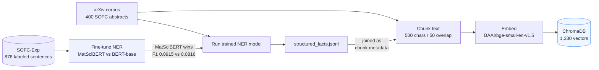
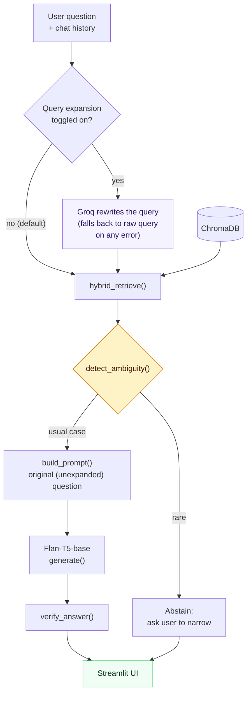

<!-- Title: MatSci-RAG Explainer -->

# MatSci-RAG — Everything You Need to Explain This Project

A study guide, not a report: every term you'll need, the complete flow narrated step by step, one
real example traced end to end, and the questions a mentor is likely to ask with model answers.
Read top to bottom once, then use the last two sections as last-minute review.

---

## 0. The One-Minute Pitch

> "I built a question-answering system for Solid Oxide Fuel Cell research papers. Instead of
> letting a language model answer from its own trained-in knowledge — which risks hallucination —
> my system retrieves real passages from a 400-paper corpus and forces the model to answer *only*
> from that retrieved text, citing its sources. On top of that, I fine-tuned a materials-science
> language model to extract structured facts (materials, devices) from the same papers, and used
> those facts to make retrieval itself smarter — combining semantic search, keyword search, and
> entity matching. I also added two reliability layers: the system double-checks its own answers,
> and it can refuse to answer rather than guess when it's genuinely unsure."

If your mentor only remembers one sentence, it should be: **retrieval keeps the model honest, and
NER makes the retrieval smarter.**

---

## 1. Core Concepts — The Vocabulary

Read these once in order — each builds on the last.

### 1.1 The hallucination problem, and why RAG exists

A large language model (LLM) like ChatGPT generates text by predicting the most likely next word,
based on patterns learned from its training data. It has no built-in way to check whether what it's
saying is *true* — it will state something false as confidently as something true if the pattern
"looks right." This is called **hallucination**.

**RAG (Retrieval-Augmented Generation)** is the standard fix: instead of asking the model to answer
from memory, you first **retrieve** real, relevant text from a trusted source, then **generate** an
answer that's instructed to use only that retrieved text. The model is no longer "recalling
facts" — it's summarizing/extracting from text you handed it, which is a much easier and more
reliable job. This is why the project is called MatSci-**RAG**.

### 1.2 Embeddings and dense (semantic) retrieval

An **embedding** is a list of numbers (a vector) that represents the *meaning* of a piece of text.
An embedding model is trained so that texts with similar meaning produce vectors that are close
together in that number-space — even if they don't share any exact words. "Electrolyte materials
for SOFCs" and "solid oxide fuel cell ion-conducting compounds" would land close together, despite
sharing almost no words.

**Dense retrieval** (a.k.a. semantic search) means: embed the user's question, embed every chunk of
your corpus, and find the chunks whose embeddings are closest to the question's embedding. "Closest"
is usually measured with **cosine similarity** (the angle between two vectors — 0° = identical
meaning, 90° = unrelated).

This project uses `BAAI/bge-small-en-v1.5` as the embedding model.

### 1.3 Vector databases

A **vector database** (this project uses **ChromaDB**) is a database built specifically to store
embeddings and answer "find me the k closest vectors to this one" queries fast, even across
millions of vectors. It also stores **metadata** alongside each vector — in this project, each
chunk's metadata includes which paper it came from, its title, and the NER-extracted entities for
that paper.

### 1.4 Chunking

Papers are too long to embed as one block (embedding models have a size limit, and a single vector
for an entire paper would blur together many different topics, hurting search precision). So each
paper's abstract is split into overlapping **chunks** (here: 500 characters each, with 50 characters
of overlap between consecutive chunks, so a fact sitting right at a chunk boundary isn't cut in
half and lost). Each chunk gets its own embedding and is a separate retrievable unit.

### 1.5 Keyword retrieval and BM25

Dense retrieval is not perfect: because it prioritizes *meaning* over *exact wording*, it can miss
an exact chemical formula, alloy name, or acronym that a plain keyword search would catch instantly.
**BM25** is a classic (pre-neural) keyword-ranking algorithm from information retrieval: it scores
documents higher when they contain the query's exact words, weighted by how rare/informative those
words are across the whole corpus. It's the same family of algorithm search engines used before
neural embeddings existed.

### 1.6 Hybrid retrieval and Reciprocal Rank Fusion (RRF)

**Hybrid retrieval** = run both dense (semantic) and BM25 (keyword) search, then combine the two
ranked lists into one. The simplest way to combine two ranked lists is **Reciprocal Rank Fusion**:
give every item a score of `1 / (60 + its rank)` in each list it appears in (the `60` is a standard
constant that keeps any single rank-1 result from completely dominating), then sum those scores
across both lists and re-sort. An item that ranks well in *both* lists rises to the top — a stronger
signal of relevance than ranking well in just one.

### 1.7 Named Entity Recognition (NER)

**NER** is the task of finding and labeling specific spans of text as belonging to a category — in
this project: `MATERIAL`, `DEVICE`, `EXPERIMENT`, `VALUE`. It's framed as **token classification**:
every individual token (word/subword piece) in a sentence gets a tag. The standard tagging scheme is
**BIO tagging**: `B-`(Begin) marks the first token of an entity, `I-`(Inside) marks the rest of a
multi-token entity, and `O` means "not part of any entity." Example:

| Token | `yttria` | `stabilized` | `zirconia` | `is` | `used` |
|---|---|---|---|---|---|
| Tag | `B-MATERIAL` | `I-MATERIAL` | `I-MATERIAL` | `O` | `O` |

### 1.8 Pretraining, fine-tuning, and domain adaptation

A model like BERT is first **pretrained** on a huge amount of general text (predicting masked
words, etc.) so it learns general language patterns — grammar, common word relationships. It's then
**fine-tuned**: continued training on a small, task-specific labeled dataset (here: SOFC-Exp, 876
NER-labeled sentences) so it specializes in your exact task.

**MatSciBERT** is the same idea, but its *pretraining* text was 2.4 million materials-science
papers instead of general Wikipedia text — so it already "knows" the vocabulary and phrasing of
this domain before fine-tuning even starts. This is called **domain-specific pretraining** /
**domain adaptation**, and the project's Phase 2 is a controlled experiment testing whether it
actually helps (it does: MatSciBERT F1 0.0915 vs. generic BERT-base F1 0.0816 — same fine-tuning,
same data, only the pretraining differs).

### 1.9 Precision, Recall, F1

Standard classification metrics, used here to score the NER model:
- **Precision** — of everything the model *labeled* as an entity, what fraction actually was one?
  (Low precision = lots of false alarms.)
- **Recall** — of everything that *actually was* an entity, what fraction did the model find?
  (Low recall = lots of misses.)
- **F1** — the harmonic mean of precision and recall; one balanced number. Low F1 means the model
  is unreliable in at least one of those two ways (in this project's case: both, and it's an honest,
  reported limitation — see Section 6).

### 1.10 Transformer model families used here

- **BERT-family (encoder-only)** — good at *understanding/classifying* text. Used here for NER
  (`m3rg-iitd/matscibert`, `bert-base-uncased`) — the model reads a sentence and outputs a label
  per token, it doesn't generate new text.
- **T5-family (encoder-decoder, instruction-tuned)** — good at *generating* new text from an
  instruction. Used here for answer generation (`google/flan-t5-base`) — it reads a prompt
  (instructions + retrieved context + question) and writes an answer.

### 1.11 Grounding, guardrails, and the anti-hallucination prompt

**Grounding** means constraining generation to only use provided context. This project's prompt
explicitly instructs Flan-T5: *"Answer using ONLY the context provided. If the answer is not
contained in the context... reply EXACTLY with: 'I don't know based on the provided context.'"*
That single instruction is the project's main anti-hallucination **guardrail**.

### 1.12 Self-verification

Even with a grounded prompt, a model can still misread its own context. **Self-verification** is a
second, independent LLM call *after* generation: show the model its own answer and the context
again, and ask "does the context actually support this claim, yes or no?" It's a smaller, cheaper
check than trusting the first answer blindly. (This project's implementation is adapted from a
technique called **ChatExtract**, Polak & Morgan — using follow-up verification prompts to raise
precision.)

**Important nuance to have ready for your mentor:** self-verification only checks *internal
consistency* — "does this answer match what I retrieved?" — not *domain correctness*. If retrieval
hands the model the wrong papers, the model can generate a wrong-domain answer, verify it against
that same wrong context, and get a confident ✅. (This is exactly what was observed live: dense-only
retrieval answered "FePO4," a battery material, for a SOFC cathode question — and self-verification
said "yes, verified," because FePO4 genuinely was supported by the *wrong* papers it retrieved.
See Section 4.)

### 1.13 Ambiguity detection / abstention

The idea: if the retrieved evidence spans many different candidate materials, the system shouldn't
silently pick one and guess — it should tell the user the question is too broad and ask them to
narrow it. Implemented by counting distinct materials (from the NER facts) across the retrieved
papers. **Be ready to discuss why this rarely fires in practice** — it's a good, honest talking
point, not something to hide (see Section 6).

### 1.14 Query rewriting / query expansion

A well-known RAG technique: instead of embedding the user's *literal* words, first have an LLM
rewrite the question into a more search-friendly form — expanding abbreviations, adding domain
synonyms, and (in a multi-turn chat) resolving pronouns like "it" or "they" using the conversation
history, since a raw pronoun embeds to nothing useful. The rewritten query is used *only* for
retrieval — the original question is still what the generator sees and answers, so a bad rewrite
can hurt what gets retrieved but can't put words in the model's mouth. This project's version
(`src/rag/query_expansion.py`) uses a small LLM via the **Groq API** and is opt-in, degrading to the
original query unchanged if the API is unavailable.

### 1.15 LLM-as-judge evaluation

A way to score generated text automatically when there's no single "correct" answer string to
diff against: ask a *separate* LLM to read the question, the answer, and the retrieved context, and
score properties like "is this faithful to the context?" on a rubric. It's cheaper and faster than
human evaluation, though only as reliable as the judge model itself — a real, honest caveat to have
ready. This project originally planned to use **RAGAS**, a popular open-source library that
implements exactly this pattern, but RAGAS's dependency chain turned out to be broken against this
project's other libraries (see Section 3.3) — so a small custom judge was built instead, using the
same *concepts* RAGAS is built on (Faithfulness, Answer Relevancy, Context Precision) without the
library itself.

### 1.16 Full-text vs. abstract-only corpora

Everything through Phase 8 indexes only paper *abstracts* — a few sentences each. An abstract is a
compressed summary; it often doesn't contain the fine-grained methodological detail (exact
temperatures, specific dopant ratios, step-by-step procedures) that a detailed question is actually
asking about. **Full-text ingestion** means downloading the actual PDF and indexing the paper's real
sections (introduction, methods, results, etc.) instead — a much deeper but noisier and slower to
build knowledge base. Worth knowing precisely: this changes what's *chunked* and *indexed*, not
anything about retrieval or generation mechanics — the rest of the pipeline (Section 3.2) is
unchanged either way.

### 1.17 Knowledge graphs

A **graph** representation of data as **nodes** (entities — here: papers and their extracted
materials/devices) connected by **edges** (relationships — here: "paper mentions material"). Unlike
a ranked list of search results, a graph view lets you see structure a plain query can't show: which
materials cluster together across many papers, which papers are hubs connecting several
technologies. This project renders one with **pyvis** (a Python wrapper that turns a `networkx`
graph into an interactive, physics-simulated HTML visualization).

---

## 2. Project-Specific Vocabulary

| Term | What it is |
|---|---|
| **SOFC** | Solid Oxide Fuel Cell — the materials-science domain this project focuses on |
| **`structured_facts.jsonl`** | The output of running the trained NER model on the corpus — one JSON record per paper, listing extracted materials/devices/experiments/values |
| **`paper_id`** | The metadata key each indexed chunk is tagged with in ChromaDB (its source paper's arXiv URL) |
| **`source_id`** | The equivalent field name inside `structured_facts.jsonl` records — same concept, different file's naming convention. (A real bug in this project came from code mixing these two names up — see Section 6.) |
| **ADR (Architecture Decision Record)** | A short document explaining *why* a technical choice was made — this project has 13 of them, in `docs/ADRs/` |
| **Phase** | This project was built in 9 sequential core phases (0–8), plus a "Phase 9" extension pass adding six further capabilities on top — see Section 3 |
| **`hybrid_retrieve()`** | The function that runs dense + BM25 search and fuses them (Section 1.6) |
| **`detect_ambiguity()`** | The function implementing Section 1.13 |
| **`verify_answer()`** | The function implementing Section 1.12 |
| **`build_prompt()`** | Assembles the retrieved context + grounding instructions + chat history + question into the final prompt sent to Flan-T5 |
| **`fuse_and_rerank()`** | The RRF + NER-boost logic (Section 1.6), lives in `src/rag/ner_utils.py` |
| **`expand_query()`** | Implements Section 1.14 (query rewriting), lives in `src/rag/query_expansion.py` |
| **ChromaDB collection `sofc_papers`** | The actual name of the vector index/table inside ChromaDB |
| **`k`** | Standard retrieval shorthand for "how many results to return" (this project defaults to k=5) |
| **Groq** | An LLM inference API this project uses for two Phase 9 features (query expansion, LLM-judge evaluation) — the one deliberate exception to the project's otherwise fully-local design, requiring a `GROQ_API_KEY` |
| **`groq/compound-mini`** | The specific (free-tier) model used via Groq for both of the above |
| **`src/ui/`** | Where the Streamlit app now lives (`app.py` + a `pages/` folder for the Analytics and Knowledge Graph pages) — it moved out of the repo root in a later restructure |

---

## 3. The Complete Flow

The system has two halves that run at completely different times.

### 3.1 Offline: Building the Index (run once, whenever the corpus changes)

**In words:** collect papers → separately, train a NER model on a *different*, already-labeled
dataset (SOFC-Exp) → run that trained model over your *own* 400 papers to extract facts → chunk the
paper text → attach the extracted facts to each chunk as metadata → embed each chunk → store
everything in ChromaDB. After this runs once, the index sits ready for any number of future queries.

### 3.2 Online: Answering One Question (runs every time a user asks something)

**In words:** if query expansion is on, an LLM first rewrites the question into a search-friendlier
form using the last few turns of chat history (Section 1.14) — otherwise the raw question is used
as-is. That (possibly rewritten) query is embedded and searched against ChromaDB (dense) *and*
tokenized and searched with BM25 (keyword), in parallel. Both ranked lists are fused (RRF) and
boosted by NER entity overlap. The system checks whether the retrieved evidence looks ambiguous; if
not (the usual case), it builds a strict, context-only prompt — using the *original*, unexpanded
question, plus recent chat history — and asks Flan-T5 to answer. That answer is then independently
re-checked by asking the same model "does the context actually support this?" Finally the UI shows
the answer, a ✅/⚠️ verification badge, and the source papers used.

### 3.3 Phase 9: Six Extensions on Top of the Core Pipeline

Everything above (Phases 0–8) was the original, complete project. A later "Phase 9" pass added six
more capabilities without changing that core design — worth being able to name and place correctly:

| Extension | What changed, concretely | Where it sits in the flow above |
|---|---|---|
| **Multi-turn memory** | `st.session_state.messages` accumulates the conversation; the last 3 turns are passed into both query expansion and `build_prompt()` | Feeds into 3.2's "User question + chat history" input |
| **Query expansion** | `expand_query()` — Section 1.14 | The new decision diamond at the top of 3.2 |
| **LLM-judge evaluation** | `scripts/evaluate_ragas.py` — a custom Groq-based scorer (Section 1.15), run *offline*, not part of the live query path | Not in the live flow at all — a separate evaluation script |
| **Full-paper ingestion** | An alternate offline pipeline: download PDFs → `pypdf` extracts text → regex splits it into sections → re-chunk and re-embed | Replaces the "Offline" pipeline's text source (3.1) — abstracts vs. full paper sections, chosen at index-build time via `--source` |
| **Knowledge graph** | A separate Streamlit page (`src/ui/pages/2_Knowledge_Graph.py`) reading `structured_facts.jsonl` directly | Not in the query flow — a standalone visualization view, not something a question passes through |
| **Analytics dashboard** | Another separate Streamlit page reading pre-built artifacts (corpus, facts, eval CSV) — no models loaded | Also not in the query flow — a read-only reporting view |

The important thing to get right if asked: **three of these six (memory, expansion, full-paper
ingestion) actually change what happens when you ask a question; the other three (LLM-judge eval,
knowledge graph, analytics) are separate tools built *around* the system, not new steps inside it.**

---

## 4. One Real Example, Traced Completely

Concrete beats abstract in a viva. This is a real run, verified in this project, not a hypothetical.

**Question:** *"What is considered a major reason for anode degradation in Ni-YSZ solid oxide fuel
cells?"*

1. **Retrieval.** The question is embedded (dense) and tokenized (BM25). Both searches run against
   the 1,330-chunk index. `fuse_and_rerank()` combines them — one paper,
   `http://arxiv.org/abs/1201.1567v1` ("Ni coarsening in the three-phase solid oxide fuel cell anode
   — a phase-field simulation study"), comes out on top.
2. **Ambiguity check.** The retrieved set's NER facts don't span an unusual number of distinct
   materials, so the system proceeds (doesn't abstain).
3. **Prompt construction.** `build_prompt()` assembles something like:
   > *"You are an expert materials science AI assistant... Answer using ONLY the context below...
   > Context: [1] Ni coarsening in the three-phase solid oxide fuel cell anode... Ni coarsening in
   > Ni-yttria stabilized zirconia (YSZ) solid oxide fuel cell anodes is considered a major reason
   > for anode degradation... Question: What is considered a major reason for anode degradation in
   > Ni-YSZ solid oxide fuel cells? Answer:"*
4. **Generation.** Flan-T5-base reads that prompt and outputs: **"Ni coarsening."**
5. **Self-verification.** A second prompt asks: *"Does the context support the claim 'Ni
   coarsening'?"* Flan-T5 answers **yes**, and the UI shows a green ✅ **Verified** badge.
6. **UI.** The user sees the answer, the verification badge, and an expandable source card quoting
   the exact retrieved passage with a link to `arxiv.org/abs/1201.1567v1`.

This exact trace is also the strongest "does it actually work" evidence to open with — screenshots
of it live in `README.md`.

**A second, more interesting trace to have ready** — the same question asked under two different
retrieval settings, because it demonstrates *why hybrid retrieval matters* better than any
explanation can:

- **Dense Only** for *"Which cathode materials show high oxygen reduction activity?"* → retrieves
  battery-cathode papers (semantically similar wording, wrong domain) → answers **"FePO4"** (a
  battery material) → self-verification says yes (correctly — it *was* supported by what got
  retrieved, which was just the wrong evidence).
- **Hybrid** for the identical question → the NER-boost pulls the genuinely relevant SOFC paper
  higher in the ranking → answers **"Perovskite."** (the correct class of SOFC cathode material,
  from "Material Discovery and Design Principles for Stable, High Activity Perovskite Cathodes for
  Solid Oxide Fuel Cells").

If a mentor asks "show me hybrid retrieval actually doing something," this is the example.

---

## 5. Questions Your Mentor Will Probably Ask

**Q: Why not just use ChatGPT / a raw LLM directly?**
A raw LLM answers from its training data with no way to verify correctness or cite a source, and it
will hallucinate confidently. RAG grounds every answer in a specific, inspectable, cited passage
from a real corpus.

**Q: Why not just fine-tune an LLM on your corpus instead of doing retrieval?**
Fine-tuning bakes facts into model weights — you can't easily see *which* fact came from *where*,
updating the corpus means retraining, and it doesn't scale well to a small, evolving dataset. RAG
keeps facts external, inspectable, and swappable without retraining anything.

**Q: What does NER actually add — isn't dense retrieval already "smart"?**
Dense retrieval only understands *semantic similarity*, which can be fooled by domain overlap in
wording (see the FePO4/battery example). NER gives the system structured, extracted knowledge of
*which specific entities* each paper actually discusses, which is used two ways: as a re-ranking
signal (boost papers whose entities match the query) and as an ambiguity signal (flag when many
different materials are in play).

**Q: Your NER F1 is only ~9%. Isn't that a failure?**
It's a real, reported limitation, not something to be defensive about. Two honest points: (1) the
*directional* finding — domain-pretrained MatSciBERT beats generic BERT under identical conditions —
is the actual scientific claim being tested, and it holds regardless of the absolute score; (2) the
low absolute number is explained and documented (SOFC-Exp is a small dataset — 876 sentences — with
heavy class imbalance, and long passages get truncated at 512 tokens, losing entities). The project
designed downstream features (ambiguity abstention) to fail safe *because of* this known limitation,
rather than pretending the NER model is more reliable than it is.

**Q: What is hybrid retrieval actually doing under the hood?**
Reciprocal Rank Fusion of dense + BM25 results, plus a small score boost for papers whose
NER-extracted entities are literally mentioned in the query. (Be ready to sketch the RRF formula:
`score = Σ 1/(60 + rank)` — see Section 1.6.)

**Q: How do you stop the model from making things up?**
Two layers: (1) the grounding instruction in the prompt, which explicitly tells the model to refuse
if the answer isn't in the context; (2) self-verification, a second independent check after
generation. Also be ready to state the honest limit of layer 2 (Section 1.12).

**Q: How did you evaluate the system? Isn't 100% hit-rate suspicious?**
20 hand-written, fact-specific test questions were evaluated against dense retrieval at k=5 — 20/20
correct. It's a real, reproducible number (`scripts/evaluate_rag.py`), but it's honestly a
*retrieval* metric on fairly specific questions with unambiguous, single correct source papers — not
a claim that generation is always perfect, and not (yet) a hybrid-retrieval-specific evaluation
across a harder, more ambiguous test set (an honestly reported gap — see Section 6).

**Q: Walk me through what happens when I type a question.**
Use Section 3.2's diagram and Section 4's trace — narrate it live.

**Q: What bugs did you find, and what does that say about your process?**
Good opening if asked about engineering rigor: a metadata key mismatch (`paper_id` vs `source_id`)
silently made the ambiguity-abstention feature dead code since it was first written; a ChromaDB
filter operator was being misused and silently returned zero results every time; fixing the first
bug then exposed a *second*, deeper problem — the ambiguity threshold, once actually reachable,
fired on NER noise instead of real signal, which was caught by testing, not assumed. All three are
documented with root-cause evidence in ADR-009, and it's a stronger story of engineering rigor than
a project with no bugs ever found (because that usually means fewer things were actually tested).

**Q: What are the limitations, and what would you do next?**
Be ready to state, unprompted if needed: NER precision is the current ceiling on the NER-driven
features (highest-leverage next step); hybrid retrieval has only been deeply verified on one known
failure case, not evaluated across a full test set yet; Flan-T5-base sometimes can't synthesize
across multiple passages even with the right source retrieved. See Section 6 for the full list.

**Q: Why Groq instead of RAGAS, if RAGAS is the standard library for this?**
It was tried first. RAGAS's dependency chain turned out to be broken against this project's other
libraries — its supported versions each require an incompatible `langchain-community` release (full
details in ADR-010). Rather than downgrade the whole stack to accommodate one evaluation library, a
small custom evaluator was written implementing the same *metrics* RAGAS is built on (Faithfulness,
Answer Relevancy, Context Precision — Section 1.15), scored by a free Groq-hosted model. This is a
good, honest example to have ready: a real engineering tradeoff, not "we didn't know about RAGAS."

**Q: Doesn't using an API (Groq) break the project's "fully local" design?**
Yes, deliberately, for exactly two optional features (query expansion, LLM-judge evaluation) — and
both degrade gracefully without it: query expansion silently falls back to the unmodified query if
`GROQ_API_KEY` is missing or the call fails, and the LLM-judge evaluator simply can't be run without
a key (it's an offline evaluation script, not something end users touch). The core answer-generation
path (Flan-T5) never calls an external API. Worth being upfront that this is a real, deliberate
tradeoff of evaluation/retrieval quality against the "everything runs locally for free" property the
rest of the project has.

**Q: Have you actually confirmed full-paper ingestion and query expansion help, or is that just the hypothesis?**
Yes — measured, not assumed, on a 55-paper full-paper subset (`RESULTS.md`'s Phase 9 Follow-up
section has the full data). Both help **independently**: query expansion roughly doubled Answer
Relevancy (0.214 → 0.429) on the same abstracts-only corpus; full-paper ingestion nearly tripled
Context Precision (0.200 → 0.543) on its own. The genuinely interesting finding — have this ready,
it's a better answer than "yes, it all worked" — is that **combining both made Relevancy collapse to
0.000**. Reading the actual generated answers (not just the scores) shows why: Flan-T5-base
(250M params, small) produces faithful-but-incoherent sentence fragments when handed longer, noisier,
PDF-extraction-artifact-laden context — and query expansion's broader rewritten queries make that
retrieved pool larger and noisier still. Each fix works; they don't simply add together. That's a
real, data-backed limit on Flan-T5-base's synthesis capacity, not a flaw in either individual
feature — and it's a stronger, more credible answer than claiming everything improved.

**Q: If faithfulness stayed at 1.0 even when the answers were garbled fragments, isn't your faithfulness metric broken?**
No — it's doing exactly what it's specified to do (checking whether the answer's words are actually
present in the retrieved context), and that's precisely the point worth making to a mentor: a
faithfulness score can be perfect while an answer is still a useless, incoherent sentence fragment,
because "faithful" and "coherent" are different properties. This project's own evaluation surfaced
that distinction concretely rather than needing to argue it in the abstract — see RESULTS.md for
the actual fragment examples (e.g. an answer that starts mid-sentence with a stray parenthesis
carried over from the PDF).

**Q: How does multi-turn memory work, and why cap it at 3 turns?**
It's a simple rolling window, not a vector-store or summarization-based memory — the last 6 messages
(3 user+assistant turns) are prepended as plain text to the prompt. The cap exists because Flan-T5's
input limit is 1024 tokens; unlimited history would eventually overflow it and silently truncate
something more important (the retrieved context). It's a deliberately simple design, chosen over
more complex memory architectures specifically because they were judged architecturally incompatible
with this project's raw-`model.generate()` approach (ADR-006, ADR-010).

**Q: What does the knowledge graph actually show — is it just decoration?**
No — it's built from the same `structured_facts.jsonl` every other NER-driven feature uses, so it's
a genuinely different *view* of real extracted data, not a separate demo dataset. It has three modes
(global, paper-centric, entity-centric) specifically because rendering all ~400 papers'
worth of entities at once with physics simulation would freeze the browser — a real, documented
engineering constraint (ADR-013), not an arbitrary UI choice.

---

## 6. Limitations — State These Before You're Asked

Mentors respect a student who volunteers limitations over one who has to be caught out. All of these
are real, verified, and already documented in this project (`RESULTS.md`, ADR-009):

1. **NER extraction quality is low** (~9% F1) — verified directly: only 2 of 400 papers have a
   recognizable real material name anywhere in their raw extracted `materials` list. This is the
   single biggest constraint on how much the NER-driven features can contribute today.
2. **Ambiguity abstention rarely triggers** — a direct consequence of #1. Its threshold is
   deliberately calibrated to fail safe (never wrongly block a normal answer) rather than reliably
   catch genuine ambiguity, because the underlying signal isn't clean enough to threshold finely.
3. **Hybrid retrieval's improvement is demonstrated on one deeply-verified case, not a full
   benchmark** — the 20-question evaluation script currently measures dense-only retrieval; a
   harder, more ambiguity-prone test set would be needed to show hybrid retrieval's benefit as a
   number, not just a case study.
4. **Generation quality is capped by model size** — Flan-T5-base occasionally can't synthesize an
   answer across multiple retrieved passages even when the right material was retrieved.
5. **Self-verification checks consistency, not correctness** — see Section 1.12's nuance.
6. **Full-paper ingestion and query expansion each help independently, but do not compose** —
   measured, not assumed (`RESULTS.md`'s Phase 9 Follow-up section, and Section 5's Q&A above).
   Combined, Answer Relevancy collapsed to 0.000 despite Context Precision still improving, because
   Flan-T5-base produces faithful-but-incoherent fragments from full-paper text made noisier still by
   expansion's broader queries. Shipping a feature and measuring its effect are different claims —
   this project now has real numbers for both, including where they conflict.
7. **The Phase 9 extensions have no automated test coverage** — unlike the core pipeline (which has
   10 pure-logic unit tests), query expansion's fallback behavior and the PDF section-detection logic
   were added without tests. (If you're reading this after that gap was closed, this item may be
   stale — check `tests/` directly.)
8. **Query expansion and the LLM-judge evaluator depend on an external API (Groq)** — the one
   deliberate departure from this project's otherwise fully-local design, with real tradeoffs
   (network dependency, rate limits, a model you don't control the weights of). Both degrade
   gracefully without it, but it's a genuine design compromise worth naming, not hiding.

---

## 7. One-Page Cheat Sheet

| | |
|---|---|
| Domain | Solid Oxide Fuel Cell (SOFC) materials science literature |
| Corpus | 400 arXiv abstracts → 1,330 chunks |
| NER model | `m3rg-iitd/matscibert` (F1 0.0915) vs `bert-base-uncased` (F1 0.0816) |
| Embedding model | `BAAI/bge-small-en-v1.5` |
| Vector DB | ChromaDB |
| Keyword retrieval | BM25 (`rank-bm25`) |
| Fusion method | Reciprocal Rank Fusion + NER entity-overlap boost |
| Generator | `google/flan-t5-base` |
| Reliability layers | Self-verification, ambiguity abstention |
| Retrieval hit-rate | 100% (20/20 hand-written questions, dense retrieval) |
| Tests | 20 automated (10 unit, 10 integration), `ruff` clean, GitHub Actions CI |
| Base paper | Maharana et al. (2025) — RAG+NER for materials-science literature |
| Key technique borrowed | ChatExtract (Polak & Morgan) — follow-up verification prompting |
| NER training data | SOFC-Exp (Brack et al., 2020), 876 labeled sentences |
| ADRs | 13 (`docs/ADRs/`) — every non-trivial technical decision, including reversed ones |
| Phase 9 extensions | Multi-turn memory · LLM-judge eval (Groq) · query expansion (Groq) · full-paper ingestion · knowledge graph (pyvis) · analytics dashboard |
| Judge/expansion model | `groq/compound-mini` via the Groq API — the one non-local piece, with graceful fallback |
| Biggest known limitation | NER precision (~9% F1) caps the NER-driven features' reliability |

*For full technical derivations, cite: [`docs/MatSci-RAG-Review.md`](MatSci-RAG-Review.md) (the formal
review), [`docs/ADRs/ADR-009-ner-aware-retrieval-reranking.md`](ADRs/ADR-009-ner-aware-retrieval-reranking.md)
(the retrieval redesign in full), and [`RESULTS.md`](../RESULTS.md) (all benchmark numbers).*
